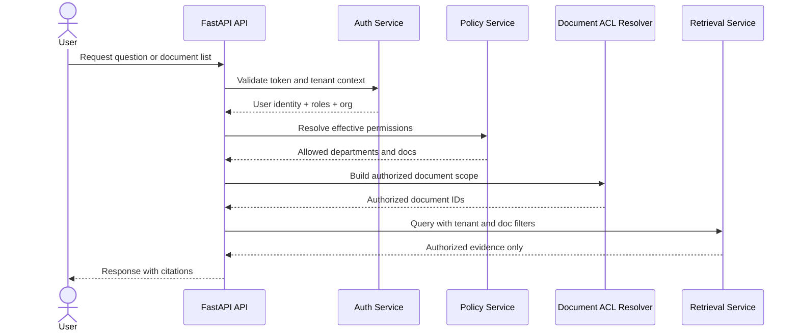

# 03. System Roles and Access Control

## 1. Authorization principles
Authorization is enforced before documents are retrieved, before context is composed, and before the LLM sees any response. No frontend or user input is trusted to decide access. Access control is based on four layers:
1. Organization membership.
2. Role-based permissions.
3. Department-level access.
4. Document-specific permissions.

## 2. User roles

### Super Admin
Responsibilities:
- Manage organizations and platform-level settings.
- Monitor system usage and health.
- Manage global configurations and provider settings.
- View operational metrics across all tenants.

Permissions:
- platform:read_all
- organization:create
- organization:manage_all
- user:manage_all
- document:read_all
- audit:read_all
- billing:read_all

### Organization Admin
Responsibilities:
- Maintain organization profile.
- Invite and manage employees.
- Create departments and assign managers.
- Manage organization document policy.
- Configure access groups and document permissions.

Permissions:
- organization:read_self
- organization:update_self
- user:invite
- user:manage_org
- department:manage_org
- document:upload
- document:manage_org
- audit:read_org
- analytics:read_org

### Department Manager
Responsibilities:
- Manage permitted department documents.
- Grant or review department knowledge access.
- Review departmental analytics.
- Maintain department membership.

Permissions:
- department:read_self
- department:update_self
- user:manage_department
- document:read_department
- document:manage_department
- analytics:read_department

### Employee
Responsibilities:
- Search authorized documents.
- Ask questions.
- View history and citations.
- Submit feedback.

Permissions:
- document:search_authorized
- chat:ask
- chat:history_view
- feedback:create
- document:read_authorized

## 3. Role-permission matrix
| Role | Auth | Org mgmt | Dept mgmt | Doc upload | Doc permission | Search | Chat | Analytics | Audit |
|---|---|---|---|---|---|---|---|---|---|
| Super Admin | Yes | Yes | Yes | Yes | Yes | Yes | Yes | Yes | Yes |
| Organization Admin | Yes | Yes | Yes | Yes | Yes | Yes | Yes | Yes | Yes |
| Department Manager | Yes | No | Yes | Yes if department-scoped | Yes within department | Yes | Yes | Yes | Limited |
| Employee | Yes | No | No | No | No | Yes if authorized | Yes | No | No |

## 4. Permission model
Permissions are defined as centralized policy records in PostgreSQL and enforced in application services before retrieval.

### Permission types
- Role permissions: system-level policy attached to roles.
- Organizational permissions: membership-based privileges within a tenant.
- Department permissions: user-to-department access.
- Document permissions: explicit grant or deny to user, group, or department.

## 5. Organization membership and department access
Every user belongs to one organization and zero or more departments. Department membership does not grant access to unrelated documents. Department access is additive only with explicit document authorization.

## 6. Document access control
Document access is computed as:
- user must be authenticated,
- user must belong to the tenant,
- tenant must match document tenant,
- user must have permission to the department or explicit document grant,
- document must be active and not soft-deleted,
- user cannot override via client-supplied IDs or hidden UI fields.

Implementation logic:
- Build an authorized document set from tenant + role + department + explicit grants.
- Intersect this set with the user’s requested query scope.
- Apply the final set to retrieval, reranking, and citation generation.

## 7. Permission precedence
Permission precedence should be:
1. Explicit deny on document or department.
2. Explicit allow on document.
3. Department allow.
4. Organization role permission.
5. Default deny.

This ensures that administrative privileges are not enough to bypass a specific deny rule.

## 8. Authorization workflow

## 9. Cross-tenant isolation
Cross-tenant leakage is prevented by:
- tenant-scoped primary keys and foreign keys,
- metadata filters in Qdrant payloads,
- PostgreSQL row-level security recommendations,
- application-level guardrails before retrieval,
- no user-controlled organization ID reliance.

## 10. Security edge cases
- Deleted user retains no document access after suspension or revocation.
- Document moved to a new department loses old access unless explicitly re-granted.
- Shared documents with conflicting permissions resolve by explicit deny > allow precedence.
- Archived documents remain inaccessible for normal queries unless policy allows access.
- Users with a stale cached token cannot access another tenant even if a client sends a different org ID.

## 11. Access control matrix
| Resource | Super Admin | Org Admin | Dept Manager | Employee |
|---|---|---|---|---|
| Platform settings | Yes | No | No | No |
| Organization users | Yes | Yes (own org) | Limited if delegated | No |
| Departments | Yes | Yes | Yes (own dept) | No |
| All org documents | Yes | Yes | Limited | No |
| Department docs | Yes | Yes | Yes | Only if authorized |
| Personal chat history | Yes (self) | Yes if org policy allows | Yes (dept scope) | Yes |

## 12. Related documents
- [02-software-requirements-specification.md](./02-software-requirements-specification.md)
- [05-database-design.md](./05-database-design.md)
- [06-api-design.md](./06-api-design.md)
- [10-security-and-privacy.md](./10-security-and-privacy.md)
