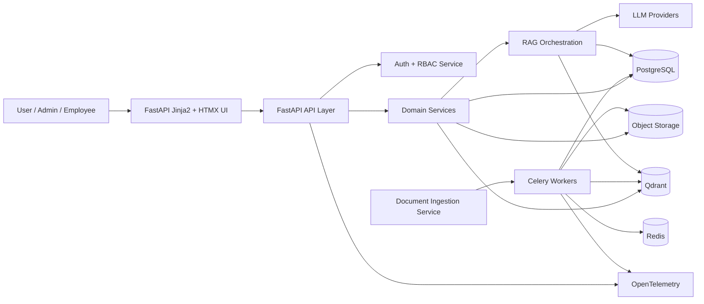
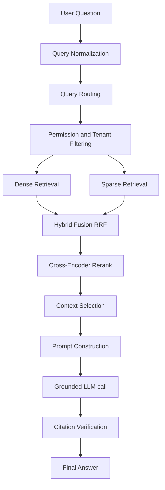
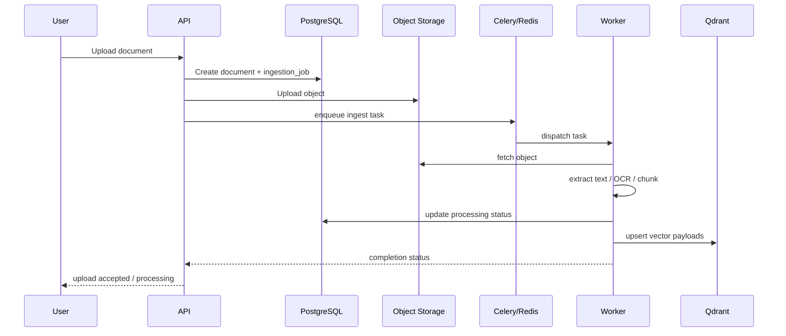
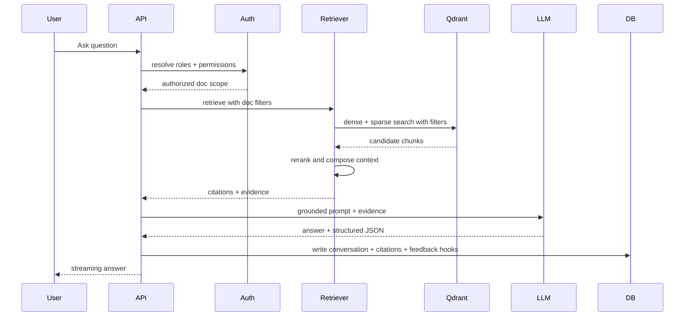
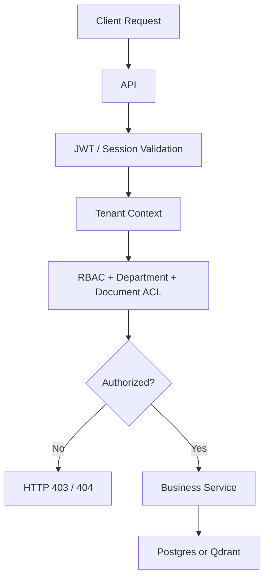

# 04. System Architecture and Design

## 1. Architecture overview
The platform uses a modular monolith as the initial architecture. It separates business logic into domain modules while sharing a single deployment footprint. This design balances delivery speed with future service extraction, enabling independent scaling of ingestion, retrieval, and chat modules as the platform grows.

## 2. Architectural principles
- Security by default and fail closed.
- Tenant-aware data boundaries.
- Explicit separation of metadata and vector payloads.
- Async processing for heavy ingestion workflows.
- Observability from the first release.
- Future service decomposition without re-architecting the core domain.

## 3. High-level architecture

## 4. Component architecture
- API Layer: routes, request validation, and response serialization.
- Auth and access layer: token validation, RBAC, and policy enforcement.
- Organization domain: tenants, users, roles, memberships, and departments.
- Document domain: document lifecycle, permissions, versions, and replacement.
- Ingestion domain: extraction, chunking, metadata, embedding, and indexing.
- Retrieval domain: dense, sparse, hybrid search, reranking, and context assembly.
- Chat domain: conversation state, streaming, answer generation, and citations.
- Governance domain: audit logs, feedback, evaluation, metrics, and monitoring.

## 5. Backend architecture
The backend is organized into modules aligned with domain responsibilities:
- app/api
- app/core
- app/auth
- app/models
- app/schemas
- app/services
- app/repositories
- app/workers
- app/rag
- app/monitoring

Service boundaries must avoid direct access from API modules to storage or vector systems that bypass policy checks.

## 6. RAG architecture

## 7. Data flow
1. User uploads document.
2. System validates type, size, hash, and scan status.
3. Metadata is persisted in PostgreSQL.
4. File is stored in object storage.
5. Celery job extracts text and metadata.
6. Chunks are created and embeddings generated.
7. Vector payloads are sent to Qdrant with tenant and document metadata.
8. User queries apply authorized tenant and department filters.
9. RAG retrieves evidence and composes a citation-backed answer.

## 8. Document ingestion sequence

## 9. Question-answering sequence

## 10. Authentication and authorization flow

## 11. Background worker architecture
- Producer: API creates asynchronous document ingestion tasks.
- Broker: Redis-backed Celery queue.
- Workers: independent processes reading tasks and processing files.
- Result backend: PostgreSQL or Redis with task status records.
- Retry and DLQ: exponential backoff, retry policies, and dead-letter handling.

## 12. External integrations
- Object storage: MinIO or S3-compatible storage.
- Vector database: Qdrant.
- LLM providers: OpenAI, Gemini, Claude, or local Ollama.
- Monitoring: OpenTelemetry, Langfuse, and related pipeline instrumentation.
- Task queue: Celery + Redis.

## 13. Deployment architecture
Recommended deployment topology:
- Reverse proxy / TLS termination in front of API.
- API app and worker containers behind same Docker Compose stack in dev and staging.
- Separate worker scaling for ingestion and retrievers in production.
- Managed PostgreSQL and Redis services for production-grade resilience.
- Object storage as S3-compatible backend with immutable bucket policies.

## 14. Scalability considerations
- Vertical scaling for initial MVP.
- Horizontal queue scaling for ingestion jobs.
- Qdrant shard and collection design to isolate tenants and document sets.
- Cache retrieval metadata in PostgreSQL or Redis for repeated document lookups.
- Move heavy inference and retrieval tasks into dedicated workers.

## 15. Fault tolerance
- Failed jobs are retried with bounded exponential backoff.
- Documents remain in a recoverable state until ingestion completes.
- New versions do not overwrite active retrievals until validation succeeds.
- Observability captures dead-letter queue and failure traces.

## 16. Architectural trade-offs
- Modular monolith vs microservices: chosen modular monolith for MVP and growth.
- PostgreSQL for metadata and Qdrant for vectors: keeps source-of-truth metadata separate from search payloads.
- Hybrid retrieval vs dense-only: hybrid improves recall and relevance for enterprise content.

## 17. Related documents
- [05-database-design.md](./05-database-design.md)
- [07-document-ingestion.md](./07-document-ingestion.md)
- [08-rag-pipeline.md](./08-rag-pipeline.md)
- [12-background-processing.md](./12-background-processing.md)
