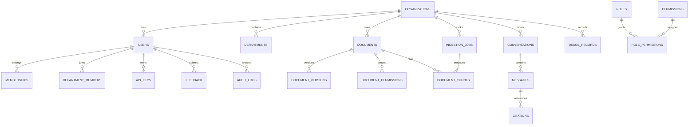

# 05. Database Design and Schema Definition

## 1. Design principles
The PostgreSQL schema stores authoritative application metadata, documents, permissions, ingestion state, conversations, usage, and audit data. Qdrant stores vector payloads and retrieval indexes for chunks. This separation preserves metadata integrity and keeps vector operations focused on speed and similarity search.

## 2. UUID and timestamp strategy
- Use UUIDv7 for most business records where globally unique, sortable IDs are desirable.
- Use `TIMESTAMPTZ` for all created/updated timestamps.
- Require `created_at`, `updated_at`, and `deleted_at` columns for soft-delete patterns.

## 3. Soft deletion strategy
Rows should not be hard deleted by default. Instead:
- `deleted_at` is set on logical deletion,
- active queries filter `deleted_at IS NULL`,
- archive and purge jobs handle retention, cleanup, and legal deletion,
- document replacement and deletion trigger vector cleanup in Qdrant.

## 4. Tenant isolation strategy
- Every tenant-scoped table includes `organization_id`.
- Foreign keys reference the same tenant.
- Application logic must reject cross-tenant access even if the query contains mismatched IDs.
- PostgreSQL row-level security is recommended as defense-in-depth, not as the only control.

## 5. Core entities
- organizations
- users
- memberships
- departments
- department_members
- roles
- permissions
- role_permissions
- documents
- document_versions
- document_permissions
- document_chunks
- ingestion_jobs
- conversations
- messages
- citations
- feedback
- audit_logs
- usage_records
- api_keys
- model_configurations

## 6. Entity Relationship Diagram


## 7. PostgreSQL DDL (excerpt)
```sql
CREATE TABLE organizations (
    id UUID PRIMARY KEY,
    name VARCHAR(255) NOT NULL,
    slug VARCHAR(100) NOT NULL UNIQUE,
    status VARCHAR(32) NOT NULL DEFAULT 'active',
    settings JSONB NOT NULL DEFAULT '{}'::jsonb,
    created_at TIMESTAMPTZ NOT NULL DEFAULT NOW(),
    updated_at TIMESTAMPTZ NOT NULL DEFAULT NOW(),
    deleted_at TIMESTAMPTZ
);

CREATE TABLE users (
    id UUID PRIMARY KEY,
    organization_id UUID NOT NULL REFERENCES organizations(id) ON DELETE CASCADE,
    email VARCHAR(255) NOT NULL,
    full_name VARCHAR(255) NOT NULL,
    password_hash VARCHAR(255),
    status VARCHAR(32) NOT NULL DEFAULT 'active',
    created_at TIMESTAMPTZ NOT NULL DEFAULT NOW(),
    updated_at TIMESTAMPTZ NOT NULL DEFAULT NOW(),
    deleted_at TIMESTAMPTZ,
    UNIQUE (organization_id, email)
);

CREATE TABLE memberships (
    id UUID PRIMARY KEY,
    organization_id UUID NOT NULL REFERENCES organizations(id) ON DELETE CASCADE,
    user_id UUID NOT NULL REFERENCES users(id) ON DELETE CASCADE,
    role_id UUID NOT NULL,
    status VARCHAR(32) NOT NULL DEFAULT 'active',
    created_at TIMESTAMPTZ NOT NULL DEFAULT NOW(),
    updated_at TIMESTAMPTZ NOT NULL DEFAULT NOW(),
    UNIQUE (organization_id, user_id)
);

CREATE TABLE departments (
    id UUID PRIMARY KEY,
    organization_id UUID NOT NULL REFERENCES organizations(id) ON DELETE CASCADE,
    name VARCHAR(255) NOT NULL,
    parent_department_id UUID REFERENCES departments(id) ON DELETE SET NULL,
    created_at TIMESTAMPTZ NOT NULL DEFAULT NOW(),
    updated_at TIMESTAMPTZ NOT NULL DEFAULT NOW(),
    deleted_at TIMESTAMPTZ,
    UNIQUE (organization_id, name)
);

CREATE TABLE department_members (
    id UUID PRIMARY KEY,
    department_id UUID NOT NULL REFERENCES departments(id) ON DELETE CASCADE,
    user_id UUID NOT NULL REFERENCES users(id) ON DELETE CASCADE,
    role VARCHAR(32) NOT NULL DEFAULT 'member',
    created_at TIMESTAMPTZ NOT NULL DEFAULT NOW(),
    UNIQUE (department_id, user_id)
);

CREATE TABLE roles (
    id UUID PRIMARY KEY,
    organization_id UUID REFERENCES organizations(id) ON DELETE CASCADE,
    name VARCHAR(128) NOT NULL,
    scope VARCHAR(32) NOT NULL DEFAULT 'organization',
    description TEXT,
    created_at TIMESTAMPTZ NOT NULL DEFAULT NOW(),
    UNIQUE (organization_id, name)
);

CREATE TABLE permissions (
    id UUID PRIMARY KEY,
    name VARCHAR(128) NOT NULL UNIQUE,
    description TEXT,
    category VARCHAR(64) NOT NULL,
    created_at TIMESTAMPTZ NOT NULL DEFAULT NOW()
);

CREATE TABLE role_permissions (
    id UUID PRIMARY KEY,
    role_id UUID NOT NULL REFERENCES roles(id) ON DELETE CASCADE,
    permission_id UUID NOT NULL REFERENCES permissions(id) ON DELETE CASCADE,
    created_at TIMESTAMPTZ NOT NULL DEFAULT NOW(),
    UNIQUE (role_id, permission_id)
);

CREATE TABLE documents (
    id UUID PRIMARY KEY,
    organization_id UUID NOT NULL REFERENCES organizations(id) ON DELETE CASCADE,
    department_id UUID REFERENCES departments(id) ON DELETE SET NULL,
    owner_user_id UUID REFERENCES users(id) ON DELETE SET NULL,
    title VARCHAR(255) NOT NULL,
    storage_key VARCHAR(512) NOT NULL,
    mime_type VARCHAR(128) NOT NULL,
    file_hash VARCHAR(128) NOT NULL,
    document_type VARCHAR(64) NOT NULL,
    status VARCHAR(32) NOT NULL DEFAULT 'uploaded',
    version_number INTEGER NOT NULL DEFAULT 1,
    current_version_id UUID,
    created_at TIMESTAMPTZ NOT NULL DEFAULT NOW(),
    updated_at TIMESTAMPTZ NOT NULL DEFAULT NOW(),
    deleted_at TIMESTAMPTZ,
    CHECK (status IN ('uploaded', 'processing', 'indexed', 'failed', 'archived', 'deleted'))
);

CREATE TABLE document_versions (
    id UUID PRIMARY KEY,
    document_id UUID NOT NULL REFERENCES documents(id) ON DELETE CASCADE,
    version_number INTEGER NOT NULL,
    storage_key VARCHAR(512) NOT NULL,
    checksum VARCHAR(128) NOT NULL,
    created_at TIMESTAMPTZ NOT NULL DEFAULT NOW(),
    UNIQUE (document_id, version_number)
);

CREATE TABLE document_permissions (
    id UUID PRIMARY KEY,
    document_id UUID NOT NULL REFERENCES documents(id) ON DELETE CASCADE,
    organization_id UUID NOT NULL REFERENCES organizations(id) ON DELETE CASCADE,
    department_id UUID REFERENCES departments(id) ON DELETE CASCADE,
    user_id UUID REFERENCES users(id) ON DELETE CASCADE,
    permission VARCHAR(32) NOT NULL DEFAULT 'read',
    grant_type VARCHAR(32) NOT NULL DEFAULT 'department',
    created_at TIMESTAMPTZ NOT NULL DEFAULT NOW(),
    CHECK (permission IN ('read', 'write', 'admin', 'deny'))
);

CREATE TABLE document_chunks (
    id UUID PRIMARY KEY,
    document_id UUID NOT NULL REFERENCES documents(id) ON DELETE CASCADE,
    version_id UUID NOT NULL REFERENCES document_versions(id) ON DELETE CASCADE,
    chunk_index INTEGER NOT NULL,
    content TEXT NOT NULL,
    page_number INTEGER,
    section_title VARCHAR(255),
    char_start INTEGER,
    char_end INTEGER,
    token_count INTEGER,
    metadata JSONB NOT NULL DEFAULT '{}',
    created_at TIMESTAMPTZ NOT NULL DEFAULT NOW(),
    UNIQUE (document_id, version_id, chunk_index)
);

CREATE TABLE ingestion_jobs (
    id UUID PRIMARY KEY,
    organization_id UUID NOT NULL REFERENCES organizations(id) ON DELETE CASCADE,
    document_id UUID REFERENCES documents(id) ON DELETE SET NULL,
    job_type VARCHAR(64) NOT NULL,
    status VARCHAR(32) NOT NULL DEFAULT 'queued',
    attempts INTEGER NOT NULL DEFAULT 0,
    max_attempts INTEGER NOT NULL DEFAULT 5,
    error_message TEXT,
    created_at TIMESTAMPTZ NOT NULL DEFAULT NOW(),
    updated_at TIMESTAMPTZ NOT NULL DEFAULT NOW(),
    started_at TIMESTAMPTZ,
    completed_at TIMESTAMPTZ,
    CHECK (status IN ('queued', 'running', 'succeeded', 'failed', 'dead_letter'))
);

CREATE TABLE conversations (
    id UUID PRIMARY KEY,
    organization_id UUID NOT NULL REFERENCES organizations(id) ON DELETE CASCADE,
    user_id UUID NOT NULL REFERENCES users(id) ON DELETE CASCADE,
    title VARCHAR(255),
    status VARCHAR(32) NOT NULL DEFAULT 'active',
    created_at TIMESTAMPTZ NOT NULL DEFAULT NOW(),
    updated_at TIMESTAMPTZ NOT NULL DEFAULT NOW()
);

CREATE TABLE messages (
    id UUID PRIMARY KEY,
    conversation_id UUID NOT NULL REFERENCES conversations(id) ON DELETE CASCADE,
    role VARCHAR(32) NOT NULL CHECK (role IN ('user', 'assistant', 'system')),
    content TEXT NOT NULL,
    model_name VARCHAR(128),
    token_count INTEGER,
    created_at TIMESTAMPTZ NOT NULL DEFAULT NOW()
);

CREATE TABLE citations (
    id UUID PRIMARY KEY,
    message_id UUID NOT NULL REFERENCES messages(id) ON DELETE CASCADE,
    document_id UUID NOT NULL REFERENCES documents(id) ON DELETE CASCADE,
    chunk_id UUID REFERENCES document_chunks(id) ON DELETE SET NULL,
    page_number INTEGER,
    section_title VARCHAR(255),
    excerpt TEXT,
    score DOUBLE PRECISION,
    created_at TIMESTAMPTZ NOT NULL DEFAULT NOW()
);

CREATE TABLE feedback (
    id UUID PRIMARY KEY,
    organization_id UUID NOT NULL REFERENCES organizations(id) ON DELETE CASCADE,
    user_id UUID REFERENCES users(id) ON DELETE SET NULL,
    conversation_id UUID REFERENCES conversations(id) ON DELETE SET NULL,
    message_id UUID REFERENCES messages(id) ON DELETE SET NULL,
    feedback_type VARCHAR(32) NOT NULL CHECK (feedback_type IN ('thumbs_up', 'thumbs_down', 'incorrect', 'hallucination', 'missing_context')),
    note TEXT,
    created_at TIMESTAMPTZ NOT NULL DEFAULT NOW()
);

CREATE TABLE audit_logs (
    id UUID PRIMARY KEY,
    organization_id UUID NOT NULL REFERENCES organizations(id) ON DELETE CASCADE,
    user_id UUID REFERENCES users(id) ON DELETE SET NULL,
    event_type VARCHAR(128) NOT NULL,
    entity_type VARCHAR(128),
    entity_id UUID,
    request_id VARCHAR(128),
    ip_address VARCHAR(64),
    details JSONB NOT NULL DEFAULT '{}',
    created_at TIMESTAMPTZ NOT NULL DEFAULT NOW()
);

CREATE TABLE usage_records (
    id UUID PRIMARY KEY,
    organization_id UUID NOT NULL REFERENCES organizations(id) ON DELETE CASCADE,
    user_id UUID REFERENCES users(id) ON DELETE SET NULL,
    resource_type VARCHAR(64) NOT NULL,
    resource_id UUID,
    model_name VARCHAR(128),
    provider VARCHAR(64),
    input_tokens INTEGER,
    output_tokens INTEGER,
    cost_usd NUMERIC(18, 8),
    latency_ms INTEGER,
    created_at TIMESTAMPTZ NOT NULL DEFAULT NOW()
);

CREATE TABLE api_keys (
    id UUID PRIMARY KEY,
    organization_id UUID NOT NULL REFERENCES organizations(id) ON DELETE CASCADE,
    user_id UUID NOT NULL REFERENCES users(id) ON DELETE CASCADE,
    name VARCHAR(128) NOT NULL,
    key_hash VARCHAR(255) NOT NULL,
    scopes JSONB NOT NULL DEFAULT '[]'::jsonb,
    expires_at TIMESTAMPTZ,
    created_at TIMESTAMPTZ NOT NULL DEFAULT NOW(),
    revoked_at TIMESTAMPTZ
);

CREATE TABLE model_configurations (
    id UUID PRIMARY KEY,
    organization_id UUID REFERENCES organizations(id) ON DELETE CASCADE,
    provider VARCHAR(64) NOT NULL,
    model_name VARCHAR(128) NOT NULL,
    mode VARCHAR(32) NOT NULL DEFAULT 'chat',
    config JSONB NOT NULL DEFAULT '{}',
    is_default BOOLEAN NOT NULL DEFAULT FALSE,
    created_at TIMESTAMPTZ NOT NULL DEFAULT NOW(),
    UNIQUE (organization_id, provider, model_name)
);
```

## 8. Recommended indexes
- `documents(organization_id, status, deleted_at)`
- `document_permissions(document_id, department_id, user_id)`
- `document_chunks(document_id, version_id, chunk_index)`
- `ingestion_jobs(organization_id, status, created_at)`
- `conversations(user_id, organization_id, updated_at)`
- `audit_logs(organization_id, created_at)`
- `usage_records(organization_id, created_at)`

## 9. RLS recommendations
- Enable row-level security for tenanted tables where the application is known to use PostgreSQL connection pooling with a tenant context.
- Use policies that constrain reads by `organization_id` and require user membership validation.
- Do not rely on RLS as the sole enforcement layer for document-level ACLs; combine it with app security.

## 10. Relationship and cascade behavior
- Organization deletion cascades to departments, users, documents, and jobs unless legal retention requirements override.
- Department deletion should clear associations and document fallback policies before deletion.
- Document deletion should set `deleted_at`, and cleanup should trigger vector removal in Qdrant.
- User deletion should preserve audit logs and possibly anonymize personal data according to retention policies.

## 11. Metadata vs vector payloads
PostgreSQL stores authoritative metadata and access-control state. Qdrant stores chunk vectors plus a payload schema such as:
```json
{
  "organization_id": "uuid",
  "document_id": "uuid",
  "document_version_id": "uuid",
  "department_id": "uuid",
  "user_access_scope": ["department:123", "user:456"],
  "source_title": "Employee Handbook",
  "page_number": 5,
  "section_title": "Benefits",
  "chunk_index": 12,
  "content_hash": "sha256",
  "deleted": false
}
```

## 12. Data retention strategy
- Active metadata retained while document is active.
- Soft-deleted items remain recoverable for a bounded period.
- Audit logs retained according to legal and compliance requirements.
- Sensitive data may require encryption at rest and secure deletion workflows.

## 13. Related documents
- [03-roles-and-permissions.md](./03-roles-and-permissions.md)
- [06-api-design.md](./06-api-design.md)
- [09-vector-database-design.md](./09-vector-database-design.md)
