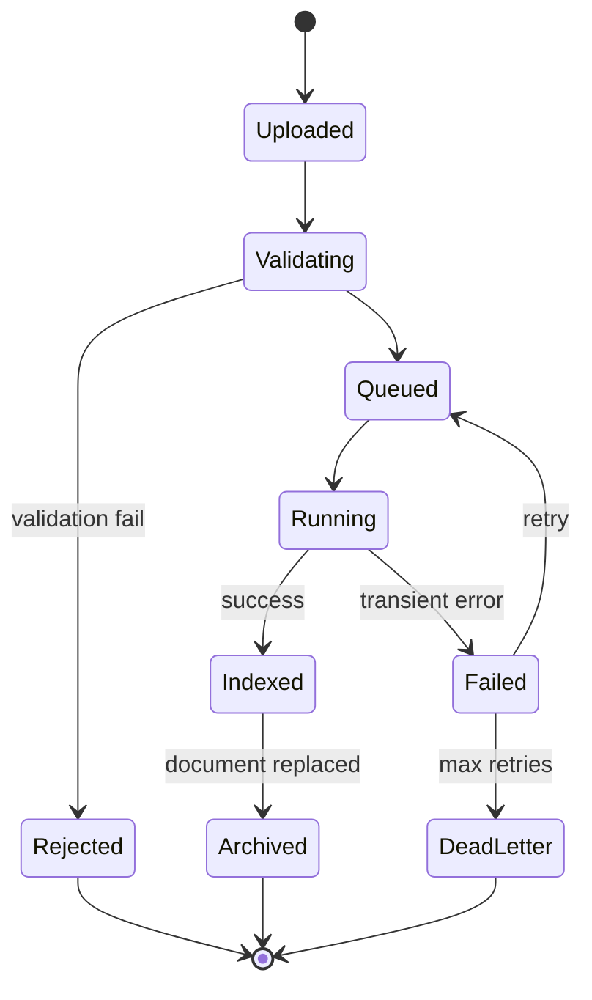

# 07. Document Ingestion and Processing Design

## 1. Ingestion objectives
The ingestion pipeline converts raw files into normalized, permission-aware chunks and vectors that are ready for retrieval. It must preserve provenance, support retries, protect against malicious input, and remain idempotent across retries and version replacements.

## 2. Upload validation
Pre-upload validation checks:
- file extension and MIME type
- maximum file size
- malware or suspicious content scan
- filename sanitization
- tenant and department context

## 3. File limits
- Proposed design goals only; values must be adjusted by enterprise policy.
- PDF: size cap per file based on tenant policy.
- DOCX/XLSX/TXT/HTML: restricted to supported set and maximum size.
- Huge files must be rejected or queued for archive processing.

## 4. Object storage and hashing
- Files are stored in object storage under a tenant key naming convention.
- Secure checksum (SHA-256) computed to detect duplicates and verify integrity.
- Versioned storage keys support replacement and rollback process.

## 5. Extraction pipeline
- PDF: PyMuPDF for text, page references, and layout metadata.
- DOCX: `python-docx` for structured paragraphs and tables.
- XLSX: `openpyxl` for tabular extraction and sheet metadata.
- HTML: BeautifulSoup parsing into semantic text blocks.
- OCR fallback for scanned PDFs and image-based input.

## 6. Structure-aware chunking
Chunking should preserve semantics and structure:
- Document section boundaries and heading hierarchy.
- Tables converted to structured text blocks.
- Consecutive paragraphs merged when within a token target.
- Chunk overlap across boundaries.

### Proposed chunking strategy
- Target size: around 700-1200 tokens depending on model.
- Overlap: 80-150 tokens.
- Preserve page numbers, sections, and titles in metadata.
- Store char offsets and chunk ordering for precise citations.

## 7. Metadata enrichment
Each chunk should carry metadata such as:
- organization_id
- document_id
- version_id
- department_id
- page_number
- section_title
- source_title
- chunk_index
- token_count
- content_hash

## 8. Duplicate detection
- Compute file hash and compare against existing active document versions.
- Prevent duplicate ingestion unless a reprocessing or re-upload is explicitly requested.
- Maintain deduplicated object-storage references where possible.

## 9. Embedding generation
Embedding service interface:
```python
class EmbeddingModel(Protocol):
    def embed_documents(self, texts: list[str]) -> list[list[float]]: ...
    def embed_query(self, text: str) -> list[float]: ...
    def model_name(self) -> str: ...
```
- Use sentence-transformer or BGE embeddings.
- Store embedding model version in metadata.
- Log provider and model config in `usage_records` and `model_configurations`.

## 10. Qdrant indexing
Each vector record should contain:
- `organization_id`
- `document_id`
- `document_version_id`
- `department_id`
- `chunk_index`
- `page_number`
- `section_title`
- `source_title`
- `content_hash`

This allows metadata filtering before retrieval and ensures cross-tenant documents are never considered.

## 11. Ingestion state machine


## 12. Background processing and retry strategy
- Celery task queue manages ingestion tasks.
- Retries use exponential backoff and jitter.
- Dead-letter handling records final outcome and preserves raw payloads.
- Reprocessing flows should be explicit to avoid accidental data loss.

## 13. Deletion and cleanup
When a document is deleted or replaced:
- mark document status as deleted or archived,
- remove active permissions for users,
- invalidate vectors in Qdrant,
- retain metadata for audits if required,
- leave object storage items in an archive bucket or purge per retention policy.

## 14. Reprocessing and versioning
- New version uploads create a new `document_versions` row.
- Existing chunk records remain linked to the old version.
- Active retrieval uses the newest approved version.
- Historical citations to earlier versions remain valid if the document record remains accessible.

## 15. Failure scenarios
- OCR is unavailable for a scanned PDF -> fallback to alternate OCR engine or mark as failed with retry.
- Extraction yields empty document -> mark ingestion as failed and notify admin.
- Duplicate file hash -> skip duplicate ingest if policy says deduplicate.
- Qdrant write fails -> record ingestion job failed and retry with idempotent upsert.

## 16. Chunk metadata example
```json
{
  "organization_id": "org_123",
  "document_id": "doc_456",
  "version_id": "ver_789",
  "department_id": "dept_1",
  "page_number": 12,
  "section_title": "Travel and Expense",
  "chunk_index": 3,
  "token_count": 840,
  "content_hash": "sha256:abc123",
  "source_title": "Travel Policy 2025"
}
```

## 17. Related documents
- [05-database-design.md](./05-database-design.md)
- [08-rag-pipeline.md](./08-rag-pipeline.md)
- [12-background-processing.md](./12-background-processing.md)
