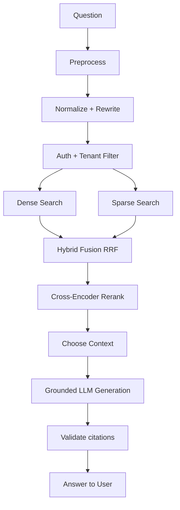

# 08. RAG Pipeline Technical Specification

## 1. Retrieval goals
The retrieval subsystem ensures that answers are grounded in authoritative, permission-safe content. Retrieval is enabled only after the user and document scope are validated, and all candidate chunks must pass tenant and document ACL checks.

## 2. Query preprocessing
- Normalize queries (lowercase, strip punctuation, normalize Unicode where required).
- Remove accidental noise or system prompts inserted by the user.
- Expand abbreviations when business context requires it.
- Route queries based on structure: FAQ, policy lookup, ambiguous fact-seeking, or document summary requests.

## 3. Query normalization and rewriting
A query can be rewritten for better retrieval without changing the user’s requirement. Examples:
- “What’s the leave policy?” -> “leave policy employee policy eligibility leave benefits”
- “Which vendors are approved?” -> “approved vendors vendor list supplier list approved vendor policy”

## 4. Tenant and permission filtering
Before retrieval, the query must resolve:
- active organization,
- user roles,
- department memberships,
- document ACLs,
- active document versions.

This requires authorization before the retrieval service executes any vector search. Qdrant filters include `organization_id`, `department_id`, and `document_id` sets and must be enforced by the backend.

## 5. Dense retrieval
Dense retrieval uses embeddings generated from the user query and stored document chunks. Search characteristics:
- preferred distance metric: cosine similarity for normalized embeddings,
- use vector payload filters for organization and document scope,
- use top-k candidate selection with a safety cap to keep the candidate pool manageable.

## 6. Sparse retrieval
Sparse retrieval uses lexical matching methods such as BM25 to improve recall for exact terminology and acronyms. Hybrid retrieval combines the best of both methods.

## 7. Hybrid retrieval using RRF
The system can combine dense and sparse results using Reciprocal Rank Fusion:
```python
for each item in dense_results + sparse_results:
    rrf_score = sum(1 / (k + rank_i))
```
This balances semantic relevance and keyword recall while maintaining direct evidence provenance.

## 8. Reranking with cross-encoder
A cross-encoder reranker refines the candidate set to prioritize chunk evidence most likely to answer the user question. It uses the query and candidate chunk text together. This is particularly useful when multiple documents share semantic similarities but differ in relevance.

## 9. Context selection and compression
The final context is chosen from reranked candidates, subject to the following rules:
- only authorized chunks may be included,
- chunk ordering reflects source relevance,
- page/section context is retained,
- citations map directly to source records,
- context compression reduces noise while preserving source quotes.

## 10. Prompt construction
Prompt design should:
- instruct the model to answer based only on retrieved evidence,
- require citations from source documents,
- refuse to answer when evidence is insufficient,
- explicitly separate retrieved excerpts from answer generation,
- reject prompt injection text from retrieved documents unless it is clearly part of the source content.

## 11. Grounded answer generation
The LLM receives a prompt containing:
- system instructions,
- user question,
- retrieved evidence with source metadata,
- formatting instructions for answer and citations,
- refusal rules if evidence is insufficient.

## 12. Structured outputs
Use Pydantic response schemas for answer output such as:
```python
from pydantic import BaseModel, Field
from typing import Literal

class Citation(BaseModel):
    document_id: str
    document_title: str
    page_number: int | None = None
    section_title: str | None = None
    excerpt: str

class AnswerPayload(BaseModel):
    answer: str
    citations: list[Citation]
    confidence: float | None = None
    status: Literal['answered', 'insufficient_evidence', 'refused']
```

## 13. Citation verification
Citations must be verified using metadata from retrieved chunks and corresponding database records. They are not independently invented by the LLM. This ensures traceability and eliminates unsupported references.

## 14. Hallucination mitigation
- Responses are grounded in retrieved evidence only.
- Uncertain or unsupported claims are avoided.
- If evidence is weak, the model responds with a refusal or asks for clarification.
- Retrieval quality is continuously evaluated using benchmark datasets.

## 15. Failure scenarios
- No authorized documents match query -> return empty answer and explain evidence gap.
- Sparse retrieval fails -> fallback to dense retrieval only if policy allows it.
- Rerank returns low-confidence candidates -> answer with insufficient evidence state.
- Vector search yields stale result -> filter to active version IDs and current status.

## 16. Example flow


## 17. Retrieval evaluation methods
- Recall@K and Precision@K on benchmark sets.
- MRR for ranked answer paths.
- Groundedness and citation accuracy by expert review or LLM-as-a-judge with caution.

## 18. Configuration parameters
- Embedding model and dimension.
- Number of retrieved docs and chunks.
- RRF constant `k`.
- Reranker model.
- Max context tokens.
- Temperature and top-p for generation.

## 19. Related documents
- [07-document-ingestion.md](./07-document-ingestion.md)
- [09-vector-database-design.md](./09-vector-database-design.md)
- [11-llm-and-prompt-design.md](./11-llm-and-prompt-design.md)
