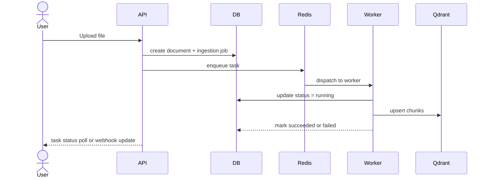

# 12. Background Job and Task Processing

## 1. Celery architecture
Celery is used for asynchronous ingestion, embedding generation, reindexing, and cleanup jobs. Redis serves as the broker and results backend in the initial deployment. Task design must preserve tenant context and user authorization.

## 2. Core job types
- document.upload
- document.extract
- document.chunk
- document.embed
- document.index
- document.replace
- document.delete
- ingestion.retry
- metrics.sync

## 3. Task lifecycle

## 4. Retry policy
- Exponential backoff with jitter.
- Maximum retries bounded by tenant policy.
- Dead-letter queue records final failure metadata.
- Retryable failures include transient extraction issues, network timeouts, and provider throttling.

## 5. Idempotency
Each ingestion task should be idempotent using:
- document version ID,
- content hash,
- deterministic chunk IDs,
- job deduplication keys.
This prevents duplicate chunks and repeated vector writes on retries.

## 6. Worker scaling
- Scale ingestion workers separately from API workers.
- Tie queue names to processing types for isolation.
- Use worker autoscaling in production for large document bursts.

## 7. Failed tasks and dead-letter handling
When a process exceeds retry limits:
- mark job as `dead_letter`,
- persist error context and stack traces,
- notify admin via monitoring or alerting,
- permit reprocessing only after a human review or operator action.

## 8. Graceful shutdown
Workers must stop accepting new jobs, flush in-flight tasks safely, and persist progress state so long-running operations can resume when the service restarts.

## 9. Monitoring and health
- Monitor task queue depth, success rate, retries, and latency.
- Track worker status and dead-letter volume.
- Emit structured logs with `request_id`, `organization_id`, and `document_id`.

## 10. Related documents
- [07-document-ingestion.md](./07-document-ingestion.md)
- [14-observability-and-monitoring.md](./14-observability-and-monitoring.md)
- [15-deployment-and-devops.md](./15-deployment-and-devops.md)
