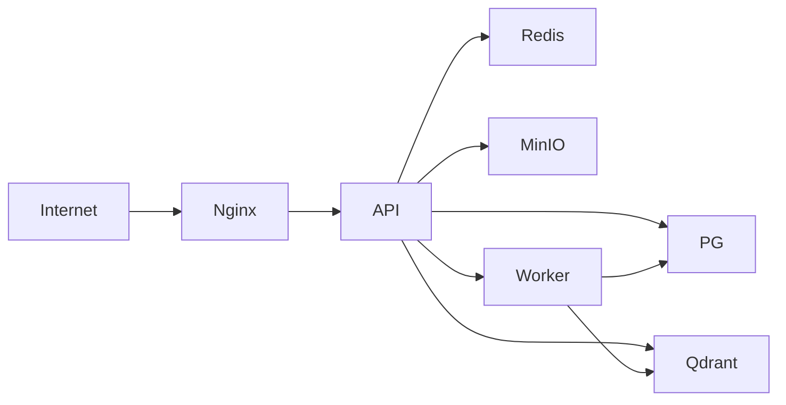

# 15. Deployment and DevOps

## 1. Environment model
The platform should support development, staging, and production. Each environment should be isolated and versioned, with distinct configuration and secrets management.

## 2. Development environment
- Docker Compose with PostgreSQL, Redis, Qdrant, MinIO, and API containers.
- Local model support via Ollama optional.
- Fast iteration and local debugging.

## 3. Deployment architecture

## 4. Docker Compose services
- `api`
- `worker`
- `postgres`
- `redis`
- `qdrant`
- `minio`
- `nginx`
- optional `ollama` or `langfuse`

## 5. CI/CD pipeline
- Lint and format checks.
- Unit and integration tests.
- Postgres schema migration test.
- Build Docker images.
- Deploy to staging after approvals.
- Promote to production by tagged release.

## 6. Secrets management
Use a managed secret store and inject through environment variables or mounted files. Avoid hardcoded credentials or local `.env` files in production.

## 7. Database migrations
Run migrations with Alembic. Validate schema changes against a staging database before promoting to production.

## 8. Production configuration
- Managed PostgreSQL and Redis.
- Secure object storage with bucket policies.
- TLS termination at reverse proxy.
- Private networking for service-to-service communication.
- Health checks and readiness probes.

## 9. Backup and disaster recovery
- Automated daily or continuous backups for Postgres.
- Object storage replicates or retains versioned snapshots.
- Recovery drills performed in staging.

## 10. Rollback strategy
- Tag releases semantically.
- Roll back by deploying the prior image tag.
- Preserve migration rollback or forward migration plans.

## 11. Related documents
- [12-background-processing.md](./12-background-processing.md)
- [14-observability-and-monitoring.md](./14-observability-and-monitoring.md)
- [19-implementation-roadmap.md](./19-implementation-roadmap.md)
