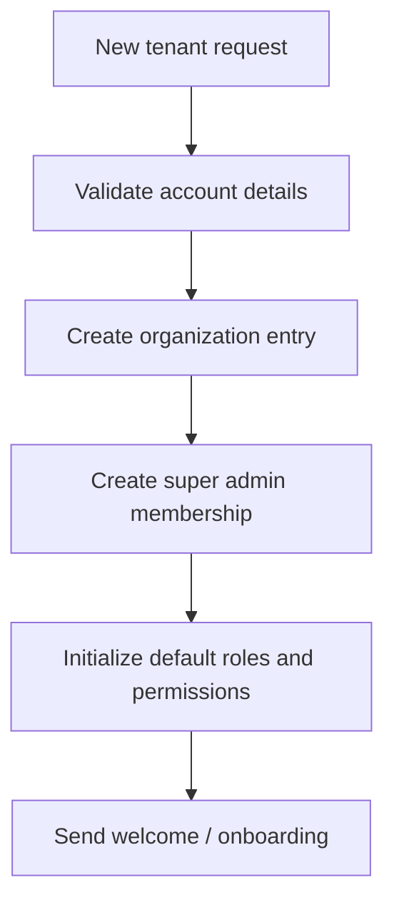

# 17. Business Logic and Workflow Documentation

## 1. Organization registration

## 2. Employee invitation and onboarding
- Invite user to organization.
- Assign default role and department.
- Create auth credentials or send activation link.
- Confirm consent and access policy.

## 3. Department creation
- Admin creates department.
- Manager is assigned.
- Department-specific policy is configured.
- Users are enrolled with explicit department membership.

## 4. Document upload and processing
- User or admin uploads a document.
- File is scanned and stored.
- Ingestion job is created and monitored.
- Text extraction, chunking, embeddings, and vector indexing occur.
- Document enters indexed state and becomes searchable.

## 5. Document access assignment
- Admin grants department or user access.
- A policy record is created.
- Authorization resolves at query time and not from UI state alone.

## 6. Question answering
- User asks a question.
- Query is normalized and context-specific filters are applied.
- Search retrieves evidence from authorized documents.
- Model generates answer with citations.
- User sees answer and metadata.

## 7. Conversation management
- Conversation history persists per user and organization.
- Users may revisit, rate, and summarize prior interactions.
- Old conversations remain access-controlled by the same rules.

## 8. Feedback submission
- User submits thumbs-up/down or note.
- Feedback is stored but does not mutate trusted knowledge automatically.
- Feedback is reviewed for evaluation and quality improvement.

## 9. Document replacement and deletion
- New version is uploaded and indexed.
- Existing documentation transitions to archived or replaced status.
- Old vectors are cleaned up.
- Deleted documents lose retrieval access immediately.

## 10. Organization suspension
- Organization status is set to inactive.
- Existing sessions are invalidated.
- Tenant-level search is denied.
- Audit log records the event.

## 11. Related documents
- [03-roles-and-permissions.md](./03-roles-and-permissions.md)
- [06-api-design.md](./06-api-design.md)
- [07-document-ingestion.md](./07-document-ingestion.md)
