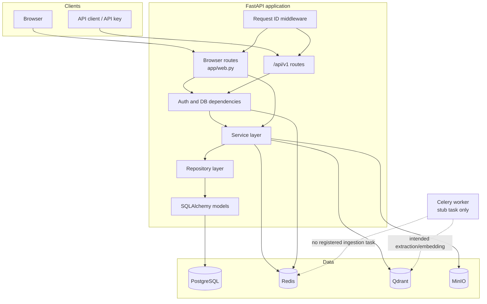
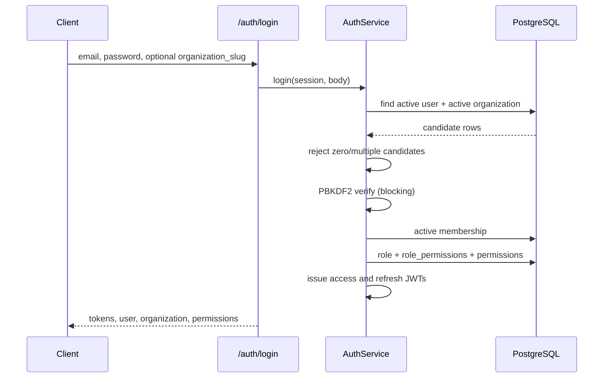

# 02 — Architecture Analysis

## 1. Summary

The application is a synchronous-request, asynchronous-I/O modular monolith. FastAPI routes delegate to service functions, services use repository classes, and repositories issue SQLAlchemy queries. PostgreSQL stores tenant metadata; Qdrant is intended for vectors; MinIO stores files; Redis supports token revocation and Celery. The architecture is coherent for an early-stage product, but several boundaries are incomplete and the asynchronous ingestion/RAG half of the system is not implemented.

**Architecture verdict:** sound skeleton, incomplete runtime path, and insufficient operational isolation for production.

## 2. Actual component diagram

## 3. Runtime composition

### 3.1 Application entry point

`app/main.py` creates a module-level FastAPI instance rather than an app factory. It:

- Configures middleware and exception handlers
- Includes `/api/v1` and browser routes
- Exposes public `/health` and `/ready`
- Runs database, Qdrant collection, and Qdrant connectivity checks in the lifespan startup
- Disposes the database engine and closes Qdrant on shutdown

Evidence: `app/main.py:17-52`, `app/main.py:55-94`.

There is no dependency-injection container, no environment-specific application factory, and no separate composition root for tests or workers. Tests therefore import the global app and monkeypatch module attributes.

### 3.2 API layer

- 46 API endpoints across 11 modules, mounted under `APP_API_V1_PREFIX` (default `/api/v1`).
- Success responses use `success_response`, which wraps data in `{data, meta}`.
- Exceptions are translated centrally for HTTP, validation, and custom application exceptions.
- Authentication is resolved by `get_current_principal` from bearer JWT, browser cookie, or `X-API-Key`.
- Every route receives `AsyncSession` through `get_db`; services own transaction boundaries.

Evidence: `app/api/v1/router.py`, `app/api/dependencies.py:74-125`, `app/api/exception_handlers.py`.

### 3.3 Service layer

The service layer contains business rules, authorization checks, tenant assertions, and transaction orchestration. It is the correct place for these concerns in this codebase. However, it is implemented as a set of module-level functions rather than classes, so dependencies are imported directly and are harder to substitute in tests.

Key services:

| Service | Responsibility |
|---|---|
| `auth_service` | Registration, login, refresh, invitation acceptance, logout, API keys, principal resolution |
| `user_service` | User listing, invitation, status update, soft deletion |
| `department_service` | Department CRUD and department member listing |
| `organization_service` | Organization CRUD and status/settings updates |
| `document_service` | Upload, versioning, ACLs, download, metadata, deletion |
| `conversation_service` | Conversation CRUD and dashboard helpers |
| `feedback_service` | Answer feedback create/read |
| `analytics_service` | Usage and document analytics |
| `admin_service` | Admin health and platform metrics |
| `chat_service` | Placeholder answer path |
| `ingestion_service` | Ingestion job reads |
| `citation_service` | Empty stub |
| `retrieval_service` | Empty stub |
| `reranking_service` | Empty stub |

### 3.4 Repository layer

Repositories wrap SQLAlchemy statements and transaction helpers. They are generally organization-scoped, with `DocumentRepository` also applying ACL predicates. The architecture test enforces that API handlers do not call session mutation/query methods directly and that services do not import the API layer or call session methods named in the test’s denylist.

Evidence: `app/repositories/base.py`, `app/tests/unit/test_layering.py`.

This is a meaningful strength: it keeps route handlers thin and centralizes tenant predicates. The rule is not complete, however: services still construct ORM objects and repositories sometimes expose persistence-shaped methods rather than domain operations. The AST test also checks only a fixed set of method names on variables literally named `db` or `session`, so it is easy to bypass accidentally.

### 3.5 Models and schema

- 21 tables are defined and auto-imported in `app/models/__init__.py`.
- IDs are custom UUIDv7 values from `app/models/mixins.py`.
- Most tenant tables carry `organization_id`; some also carry `deleted_at`.
- PostgreSQL-specific `JSONB` and `Uuid` types are used.
- Enum-like values are generally `String` with selected check constraints; many are not constrained.

Evidence: `app/models/`, `app/tests/unit/test_models.py`.

### 3.6 Integrations

| Integration | State | Notes |
|---|---|---|
| Qdrant client | Implemented wrapper | Creates one unnamed dense-vector collection and payload indexes. |
| MinIO storage | Implemented wrapper | Lazy bucket creation, upload, download, delete, presigned URL. |
| Redis client | One-line stub | Auth constructs its own client from settings. |
| LLM factory/providers | Stubs | No provider implementation. |
| RAG extractors/chunkers/retrievers/generators | Stubs | Protocol/base types only in most modules. |
| Celery app | Minimal | No ingestion task registered. |

Evidence: `app/integrations/qdrant/client.py`, `app/integrations/storage/minio_storage.py`, `app/integrations/redis/client.py`, `app/workers/celery_app.py`, `app/workers/ingestion_worker.py`, `app/rag/`.

## 4. Request flows

### 4.1 Login

This flow performs several sequential queries and a CPU-expensive password hash directly on the event loop. There is no rate limiter or lockout.

### 4.2 Authenticated API request

1. `get_current_principal` prefers `X-API-Key`, then bearer token, then browser cookie.
2. API keys are hashed with SHA-256, looked up in PostgreSQL, checked for revocation/expiry, then the owning user is loaded and checked.
3. JWT claims are verified with HMAC-SHA256, expiry checked, and Redis checked for revocation.
4. Active user, active membership, active organization, role, and permissions are resolved in separate queries.
5. Route calls a service function; service repeats tenant checks and permission checks.
6. Repository query applies organization and, for documents, ACL filters.

Evidence: `app/api/dependencies.py:84-125`, `app/services/auth_service.py:298-354`, `app/repositories/auth_repository.py`.

### 4.3 Document upload

1. Route receives multipart file, title, document type, optional department ID.
2. Service validates `document:write`/owner/admin, department tenant, extension, and size.
3. File is read fully into memory, SHA-256 hashed, and checked for an organization-wide duplicate.
4. Document, version, and ingestion job ORM objects are created.
5. File is uploaded to MinIO under a tenant/document path.
6. IDs are assigned, rows committed, and a 202 response returns the job/document.
7. No task is dispatched; the job remains `queued`.

Evidence: `app/api/v1/documents.py:56-74`, `app/services/document_service.py:117-200`.

### 4.4 Chat

1. Route enforces conversation ownership if a conversation ID is supplied.
2. Service checks `chat:ask`, then counts indexed documents in the organization.
3. If zero, it persists the user message and an `insufficient_evidence` assistant message.
4. If any indexed documents exist, it raises HTTP 503 because retrieval/generation is not configured.
5. Streaming always buffers the same placeholder output into a single SSE event.

Evidence: `app/api/v1/chat.py`, `app/services/chat_service.py:16-84`.

### 4.5 Browser routes

Browser routes use the same auth dependency and cookie. They render server-side templates. The `/` route has a confirmed typo that calls `request.cookies.et(...)`, which raises `AttributeError`. Browser login sets only an access-token cookie, with no refresh flow, no CSRF token, and no permissions/UI wiring beyond read-only pages.

Evidence: `app/web.py:20-25`, `app/web.py:36-70`, `app/templates/`.

## 5. Architectural strengths

1. **Clear intended layering.** Routes → services → repositories → models is consistently named and mostly followed.
2. **Enforced boundary checks.** `test_layering.py` catches obvious direct DB access in routes and API imports in services.
3. **Server-resolved tenancy.** `Principal` is built from the token/API key, not from client-supplied organization IDs.
4. **Centralized response and exception handling.** API output and errors are mostly consistent.
5. **Custom UUIDv7 identifiers.** Time-sortable IDs are a good choice for index locality.
6. **Async I/O.** PostgreSQL, Qdrant, and Redis use async clients; MinIO calls are wrapped in `asyncio.to_thread`.
7. **Versioned document model.** The schema anticipates versions, jobs, chunks, citations, and feedback.
8. **Infrastructure isolation.** Qdrant and MinIO are behind adapters, making future replacement feasible.
9. **Security-conscious API keys.** Only SHA-256 hashes are stored, scopes are limited to the creator’s permissions, and revocation/expiry are checked.
10. **Startup checks fail fast.** The app refuses to start when PostgreSQL or Qdrant is unavailable or dimensions mismatch.

## 6. Architectural weaknesses and risks

### 6.1 The core product path is absent

The design claims document ingestion and RAG, but:

- No extractor, cleaner, chunker, embedding provider, retriever, reranker, prompt, or LLM provider is implemented.
- No Celery task is registered.
- Uploads create jobs that never run.
- Chat refuses to answer once any document is indexed.

This is the largest functional gap. The current application is a document-registration and auth system, not a working RAG product.

### 6.2 Authorization is fragmented

Permissions are checked ad hoc inside services. `require_permissions` exists but is unused. This has already produced inconsistent behavior: some endpoints check role/permission, others only check tenant membership, and department-scoped permissions are not consistently applied to department-scoped data. See `05-security-audit.md`.

### 6.3 Department scoping is not a first-class authorization boundary

Document ACLs include a department grant type, but the management authorization helper only checks whether the principal has `document:manage_department`; it does not verify that the document belongs to the manager’s department. Similarly, analytics accepts `analytics:read_department` but queries the whole organization. Department scope is therefore a label, not an enforced boundary.

### 6.4 Transactional boundaries span external services

Document upload and deletion combine PostgreSQL transactions with MinIO/Qdrant operations. Qdrant deletion is attempted after the database commit. A Qdrant failure leaves orphan vectors and makes the operation non-retryable through the now-deleted document. Upload stores the object before commit but has no compensating cleanup if commit fails. There is no outbox or reconciliation job.

### 6.5 No asynchronous task contract

The worker module has no task, no queue routing, no retries, no idempotency, and no dead-letter handling. Job rows include attempts and errors, but no code updates them. Graceful shutdown and task lifecycle settings are absent.

### 6.6 Operational visibility is minimal

There are request IDs and health endpoints, but:

- No structured logging configuration
- No metrics endpoint usable by Prometheus
- No tracing
- No error tracking
- No audit event emission
- No usage-record emission
- No MinIO check in readiness or admin health

### 6.7 Deployment architecture is development-only

Compose exposes stateful services on host ports and has no TLS/reverse proxy, secrets management, backups, resource limits, or worker migration step. The Docker image installs base dependencies only, so AI functionality could not run even if implemented.

### 6.8 Tests do not exercise the architecture

There are architecture tests, but no integration test proves a request reaches a repository against a real or mocked database. No test boots the worker, exercises migrations, or validates tenant isolation. The confirmed browser bug is not covered.

## 7. Dependency and coupling assessment

| Relationship | Assessment |
|---|---|
| API → services | Good direction; routes are thin. |
| Services → repositories | Good direction; some services still construct ORM objects directly. |
| Repositories → models | Expected. |
| Services → external integrations | Direct module-level imports and global clients reduce testability. |
| Auth dependency → database/Redis | Re-resolves identity on every request with multiple queries. |
| Worker → services | Not connected. |
| RAG modules → integrations | Not connected. |
| Browser → services | Reuses services correctly in principle, but UI coverage is partial. |

Circular-import avoidance currently relies on function-local imports (for example `app/services/auth_service.py:186`, `app/services/document_service.py:83`, `app/repositories/conversation_repository.py:60`). This works but indicates module boundaries could be cleaner.

## 8. Architectural recommendations

### Immediate

1. Fix the browser cookie bug and add a browser route test.
2. Make authorization a single service-level policy layer with explicit tenant and department scopes.
3. Add an initial Alembic migration and a migration check before readiness.
4. Add a bootstrap path for the first platform super-admin.
5. Define and implement one end-to-end ingestion task before claiming RAG capability.
6. Make readiness include every dependency required for the advertised request path.

### Near term

7. Introduce an application factory and dependency injection for settings, sessions, storage, vector store, and queue to improve testability.
8. Replace direct external calls inside business transactions with a job/outbox pattern and idempotent consumers.
9. Add structured logging, metrics, tracing, and audit/usage emission at service boundaries.
10. Add integration tests against ephemeral PostgreSQL/Qdrant/Redis/MinIO or contract-tested fakes.
11. Split the consolidated request schema module into domain schema modules and generate typed response models.
12. Add explicit deletion/reconciliation workflows for Qdrant and MinIO.

### Longer term

13. Add hybrid retrieval only after the dense path is correct and measured.
14. Introduce read/write separation or caching for principal resolution.
15. Add organization-level rate limits, quotas, and model-cost controls.
16. Evaluate row-level security as defense in depth while retaining repository filters.

## 9. Architecture scorecard

| Dimension | Score (1–5) | Rationale |
|---|---:|---|
| Layering clarity | 4 | Clear intended boundaries and a test, but incomplete enforcement. |
| Functional completeness | 2 | Auth/CRUD exists; ingestion/RAG missing. |
| Tenant isolation | 3 | Server-resolved org scoping is good; department and data-integrity gaps remain. |
| Authorization consistency | 2 | Ad hoc checks and confirmed scope leaks. |
| Transactional correctness | 2 | External systems are not coordinated with database commits. |
| Testability | 2 | Module-level functions and global app/clients hinder substitution. |
| Observability | 1 | Request ID and health only. |
| Deployability | 2 | Local Compose works; production controls absent. |
| Scalability readiness | 2 | Async I/O helps, but blocking hashing, N+1 auth, and no worker pipeline limit it. |
| Documentation accuracy | 2 | Specs describe aspirational behavior and already drift from code. |

## 10. Conclusion

The codebase has a sensible skeleton and several good security instincts, particularly server-resolved tenancy, scoped API keys, and ACL-aware document queries. It is not a functioning RAG platform yet. The highest-value architectural work is not adding more modules; it is making authorization scopes real, completing one vertical ingestion-to-chat slice, and establishing migrations, tests, and operational controls around it.
