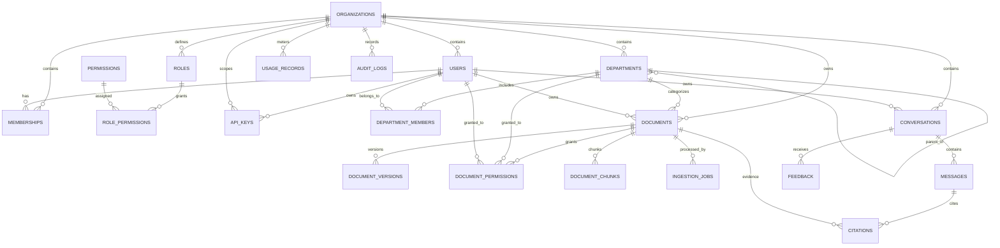

# 03 — Database Analysis

## 1. Summary

The PostgreSQL schema is broad and thoughtfully modeled for a multi-tenant RAG product, but it is not deployable as-is. There are no Alembic migrations, several referential-integrity constraints are missing, and soft-delete semantics are not consistently enforced. The schema is best treated as a reviewed draft rather than a production database contract.

**Database verdict:** useful schema design, incomplete integrity model, no migration path, and unsafe soft-delete behavior.

## 2. Persistence configuration

- Declarative base: `app/database/base.py`
- Engine/session factory: `app/database/session.py`
- ORM model auto-import: `app/models/__init__.py`
- UUIDv7 primary keys: `app/models/mixins.py:9-28`
- Alembic configuration: `alembic.ini`, `alembic/env.py`
- Migration directory: `alembic/versions/`

The engine is created at import time from `settings.database.url`. The session dependency yields an `AsyncSession`; services and repositories explicitly commit. There is no unit-of-work abstraction, no retry policy, and no statement timeout.

## 3. Table inventory

There are 21 tables. Test coverage asserts the exact set in `app/tests/unit/test_models.py`.

| # | Table | Model | Purpose | Tenant column |
|---:|---|---|---|---|
| 1 | `organizations` | `Organization` | Tenant/root entity | self |
| 2 | `users` | `User` | Tenant-scoped user identity | `organization_id` |
| 3 | `roles` | `Role` | Organization or platform roles | nullable `organization_id` |
| 4 | `permissions` | `Permission` | Global permission catalog | none |
| 5 | `role_permissions` | `RolePermission` | Role-to-permission mapping | via role |
| 6 | `memberships` | `Membership` | User-to-role mapping | `organization_id` |
| 7 | `api_keys` | `APIKey` | Hashed API keys and invitation tokens | `organization_id` |
| 8 | `departments` | `Department` | Hierarchical departments | `organization_id` |
| 9 | `department_members` | `DepartmentMember` | User-to-department mapping | via department/user |
| 10 | `documents` | `Document` | Document metadata/current version | `organization_id` |
| 11 | `document_versions` | `DocumentVersion` | Immutable file revisions | via document |
| 12 | `document_permissions` | `DocumentPermission` | User/department/organization ACL grants | `organization_id` |
| 13 | `document_chunks` | `DocumentChunk` | Chunk metadata; vectors live in Qdrant | via document |
| 14 | `ingestion_jobs` | `IngestionJob` | Asynchronous ingestion state | `organization_id` |
| 15 | `conversations` | `Conversation` | Chat sessions | `organization_id` |
| 16 | `messages` | `Message` | Conversation messages | via conversation |
| 17 | `citations` | `Citation` | Answer-to-evidence links | via message/document |
| 18 | `feedback` | `Feedback` | Answer quality feedback | `organization_id` |
| 19 | `usage_records` | `UsageRecord` | Model/cost/latency usage | `organization_id` |
| 20 | `audit_logs` | `AuditLog` | Security/business audit events | `organization_id` |
| 21 | `model_configurations` | `ModelConfiguration` | Tenant or platform LLM config | nullable `organization_id` |

There is no standalone `invitations` table in this implementation; invitation tokens are stored as scoped API keys in `api_keys`. `document_chunks` and `model_configurations` have models but no application service/repository usage yet.

## 4. Entity relationships



Some relationships shown here are conceptual, not database-enforced. In particular, `memberships.role_id`, `documents.current_version_id`, and `citations.chunk_id` relationships have no foreign key, and multi-tenant consistency is not enforced with composite keys.

## 5. Critical schema findings

### 5.1 No migrations (Critical/High)

`alembic/versions/` contains no revision files. The application startup checks database connectivity but does not create tables or verify schema version. A fresh PostgreSQL database will accept connections and cause every table query to fail.

Evidence: `alembic/versions/`, `alembic/env.py`, `app/main.py:24-43`, `app/database/init_db.py` (empty).

Impact:

- Fresh installations cannot work.
- There is no upgrade/downgrade path.
- Schema changes are unreviewable and untested.
- `/ready` can return 200 while the schema is missing or stale.

Remediation:

1. Generate and review an initial migration covering all 21 tables, constraints, and indexes.
2. Add a migration startup gate or verify `alembic_version` in readiness.
3. Add a migration job/step to deployment and CI.
4. Add a test that applies migrations to an empty database and compares the resulting schema to the models.

### 5.2 Missing foreign key on `memberships.role_id` (High)

`app/models/membership.py:24`:

```python
role_id: Mapped[UUID] = mapped_column(nullable=False)
```

There is no `ForeignKey("roles.id")`. This permits orphan memberships and cross-tenant roles. `resolve_principal` loads the role by ID without checking the role’s organization, so a corrupt or maliciously written row could grant another tenant’s permissions.

Remediation: add the foreign key and a composite tenant-consistency strategy. At minimum, validate `Role.organization_id` in the role lookup and add an integrity test.

### 5.3 Missing foreign key on `documents.current_version_id` (Medium/High)

`app/models/document.py:55` stores `current_version_id` as a bare UUID. It does not reference `document_versions.id`, so it can point to a deleted, nonexistent, or different document’s version. Version rows are never deleted by current code, which masks the problem.

Remediation: add a post-creation foreign key (Alembic can add it after both tables exist) with an appropriate `ON DELETE SET NULL`, plus a consistency check that the version belongs to the same document.

### 5.4 `document_chunks.version_id` is not tied to `document_id` (Medium)

`DocumentChunk` has separate foreign keys to `documents.id` and `document_versions.id`. Nothing ensures the version belongs to the document. Future ingestion could create inconsistent chunk/version pairs.

Remediation: enforce in ingestion and consider a composite unique/FK strategy `(document_id, version_id)`. At minimum, validate before insert.

### 5.5 Cross-tenant references are not prevented (High integrity risk)

Most tenant tables use a simple foreign key to the target row, not a composite `(organization_id, id)` foreign key. Examples:

- `document_permissions.department_id` can reference a department in another organization if service validation is bypassed.
- `document_permissions.user_id` can reference a user in another organization.
- `messages.conversation_id` and `citations.document_id` can point across tenants.
- `department_members` links user and department without a shared-tenant constraint.

Services usually validate both IDs, but database integrity should not depend on every code path remembering to do so. The missing `memberships.role_id` FK is the clearest example of this class.

Remediation options:

- Add composite unique keys on `(organization_id, id)` and composite foreign keys.
- Alternatively, use PostgreSQL row-level security plus triggers for cross-tenant checks.
- Add integration tests that attempt cross-tenant references through repositories.

## 6. Constraint and validation gaps

| Area | Gap | Impact |
|---|---|---|
| `document_permissions.grant_type` | No check constraint; arbitrary strings accepted | Invalid rows are silently ineffective or confusing |
| `document_permissions` uniqueness | No unique constraint on `(document_id, grant_type, target)` | Duplicate grants; replacement semantics can be ambiguous |
| `documents(organization_id, file_hash)` | No unique index | Concurrent uploads can both pass duplicate check |
| `api_keys.key_hash` | No unique index | Hash collisions/corruption cannot be detected; lookup relies on non-unique column |
| `roles` platform scope | `organization_id` nullable and unique constraint permits multiple NULL platform roles | Duplicate platform roles possible |
| `users.status` | No check constraint | Arbitrary status values possible |
| `memberships.status` | No check constraint | Arbitrary membership states possible |
| `departments` hierarchy | Parent can be a descendant; only self-parent is rejected | Department cycles possible |
| `document_versions.version_number` | No positive-value check | Zero/negative versions possible |
| `ingestion_jobs.attempts` | No `attempts >= 0` or `attempts <= max_attempts` check | Invalid state possible |
| `model_configurations` | No check on `mode`; nullable organization with unique constraint allows duplicate globals | Ambiguous model selection later |
| `organizations.status` | No check constraint | Arbitrary tenant state |
| `feedback.message_id/conversation_id` | No consistency check between message and conversation | Feedback can point to unrelated records |

Some checks exist and are good: document status, ingestion status, message role, feedback type, and document permission values.

## 7. Index analysis

PostgreSQL does not automatically index foreign-key columns. Current indexes:

| Index | Table | Assessment |
|---|---|---|
| `uq_users_org_email` | `users` | Good for login and user listing. |
| `uq_memberships_org_user` | `memberships` | Good for tenant membership lookup. |
| `uq_roles_org_name` | `roles` | Good for role lookup by organization/name. |
| `uq_departments_org_name` | `departments` | Good for uniqueness; does not support member lookups. |
| `uq_department_members` | `department_members` | Good for `(department_id, user_id)` but not user-first lookups. |
| `ix_documents_org_status_deleted_at` | `documents` | Good for tenant/status listing. |
| `uq_doc_versions_number` | `document_versions` | Good for version lookup by document. |
| `ix_document_permissions_doc_dept_user` | `document_permissions` | Starts with `document_id`; poor for ACL evaluation by user/department. |
| `ix_ingestion_jobs_org_status_created_at` | `ingestion_jobs` | Good for org/status; not document-first. |
| `ix_conversations_user_org_updated_at` | `conversations` | Good for conversation lists. |
| `ix_usage_records_org_created_at` | `usage_records` | Good for usage time series. |
| `ix_audit_logs_org_created_at` | `audit_logs` | Good for audit listing. |

Missing or weak indexes that matter:

| Query path | Missing index | Consequence |
|---|---|---|
| ACL access filter: memberships by `user_id` | `department_members(user_id)` (or `(user_id, department_id)`) | Every document list subquery scans department memberships. |
| ACL access filter: grants by `user_id`, `department_id` | `document_permissions(user_id)`, `(department_id)`, and possibly `(organization_id, document_id)` | ACL `EXISTS` predicates may scan large permission tables. |
| API key lookup by hash | `api_keys(key_hash)` | Every authenticated API-key request scans the key table. |
| Messages for a conversation | `messages(conversation_id, created_at)` | Conversation history loads scan/ sort all messages. |
| Citations for a message | `citations(message_id)` | Citation loading scans all citations. |
| Citations/document deletion | `citations(document_id)` | Cascading document deletion scans citations. |
| Feedback by message | `feedback(message_id)` | Feedback lookup/scan is inefficient. |
| Ingestion jobs by document | `ingestion_jobs(document_id)` | Document job listing filters after an org/status index. |
| Documents by owner/department | `documents(owner_user_id)`, `(department_id)` | Owner/department filters can scan tenant documents. |
| API keys by user/org | `api_keys(user_id)`, `(organization_id)` | Key listing and revocation scans. |

Index additions must be measured against write cost, but several of these are required at even modest scale.

## 8. Soft-delete and lifecycle semantics

### 8.1 Department soft deletion leaves access intact (High)

`delete_department` sets `deleted_at` and commits. It does not:

- Delete or deactivate `department_members`
- Remove `document_permissions` rows for the department
- Clear `documents.department_id`

`DocumentRepository.access_filter` builds `department_ids` from `DepartmentMember` without joining `Department.deleted_at`, so members of a deleted department still satisfy the ACL. Documents remain accessible through a department that users can no longer see in department lists.

Evidence: `app/services/department_service.py:110-127`, `app/repositories/document_repository.py:156-183`.

### 8.2 Document deletion does not delete stored objects (High)

`delete_document` marks the row deleted and attempts Qdrant cleanup, but never deletes the current object or prior versions from MinIO. Storage grows indefinitely and sensitive content remains in the object store after “deletion.” An audit of retention/privacy claims should treat this as a data-deletion failure.

Evidence: `app/services/document_service.py:309-347`.

### 8.3 Document deletion commits before vector cleanup (High reliability)

The database state is committed before Qdrant deletion. If Qdrant fails:

- The API returns 503, but the document is already disabled.
- A retry through the authorized path returns 404.
- Orphan vectors remain searchable if retrieval is later implemented.

An outbox/reconciliation job is needed.

### 8.4 Soft-deleted unique values block reuse (Medium)

- A soft-deleted user’s `(organization_id, email)` still occupies the unique index; reinviting the same email returns 409.
- A soft-deleted department’s `(organization_id, name)` still blocks recreating that name.
- Soft-deleted organizations retain their globally unique slug.

This may be intended for auditability, but there is no restore endpoint or documented policy.

### 8.5 User deletion does not revoke related records (Medium)

`delete_user` sets status and `deleted_at` but does not revoke API keys or invitations. Principal resolution checks user status, so active keys stop authenticating, but stale key rows remain. There is no cleanup or retention job.

## 9. Transaction and concurrency behavior

| Scenario | Behavior | Risk |
|---|---|---|
| Initial organization registration | Advisory transaction lock serializes registration | Good, but only one organization can ever self-register |
| Concurrent duplicate upload | Both check before either commits, no unique index | Duplicate rows |
| Concurrent department rename | Unique constraint catches second commit | Handled with 409 |
| Concurrent invite same email | Unique constraint catches, but session not rolled back before raising | Potential session state issue if reused |
| ACL replacement | Delete-all then insert-all in one transaction | Atomic, but duplicates within request allowed |
| Document delete + Qdrant delete | DB commit first, external delete second | Orphan vectors, non-retryable |
| Upload + MinIO + DB commit | MinIO upload before DB persist; DB failure triggers best-effort delete | Reasonable compensation, but delete failure leaves orphan |
| Refresh token rotation | Redis check then revoke, no atomic compare-and-set | Two concurrent refreshes can succeed |
| Role/permission creation for first org | Multiple flushes and inserts in one transaction | Slow but atomic |

`AuthRepository.create_initial_organization` uses `pg_advisory_xact_lock`, which is a sound approach to single-initial-registration. It also lazily creates global permission rows. It does not seed platform-level roles or future organizations.

## 10. Migration and deployment requirements

To make the schema deployable:

1. **Create the initial migration.** Use `alembic revision --autogenerate -m "initial schema"` in an environment with all models imported.
2. **Review autogenerate output.** Add missing FKs/indexes/checks that ORM metadata does not express, especially `memberships.role_id` and `documents.current_version_id`.
3. **Set a deterministic naming convention.** Without one, autogenerate constraint names vary and upgrades become fragile.
4. **Add a migration gate.** Run `alembic upgrade head` before API/worker startup, and fail startup if the schema revision is below the required revision.
5. **Test from empty.** Apply all migrations in CI against a disposable PostgreSQL instance.
6. **Test upgrade paths.** Once a second revision exists, test `N-1 -> N`.
7. **Document data retention and deletion.** Align soft-delete, object storage, Qdrant, and audit retention.
8. **Consider RLS later.** Repository filtering remains the first line; RLS is defense in depth, not a substitute for missing checks.

## 11. Query and repository concerns

- `serialize_model` iterates `model.__table__.columns` and excludes `password_hash`/`key_hash`. This is good but easy to misuse; response DTOs should be explicit.
- `list_permissions` has no deterministic order, so API responses can vary.
- `find_acl_target` chooses `Department` vs `User` based only on `grant_type`; the `organization` branch is handled earlier by skipping target validation, which contributes to the org-wide ACL escalation.
- `replace_permissions` deletes and inserts without `rollback()` if an `IntegrityError` occurs; the service raises 422 and the request session is discarded, but the repository itself is not safe to reuse after the exception.
- `UserRepository.save` commits and refreshes for a single field update; acceptable but creates many small transactions.
- `DocumentRepository.persist_initial_upload` calls `add(document)` after the document was already added and flushed. SQLAlchemy tolerates this, but it is redundant and obscures intent.
- `DocumentRepository.access_filter` uses a correlated `EXISTS` for each ACL check; with missing indexes, this is likely the dominant query cost.
- `AnalyticsRepository.usage_summary` returns `Decimal`/`float` conversions in service; empty aggregates are coalesced, which is good.
- `DocumentRepository.find_duplicate` returns only an ID, which is enough for the 409 response but leaks that ID to callers.

## 12. Database scorecard

| Dimension | Score (1–5) | Rationale |
|---|---:|---|
| Schema coverage | 4 | Broad, coherent table set for the product domain. |
| Referential integrity | 2 | Important FKs missing; cross-tenant consistency relies on code. |
| Constraint quality | 2 | Some good checks; many enum/state fields unconstrained. |
| Index coverage | 2 | Core tenant indexes exist; ACL/message/key paths are weak. |
| Migration readiness | 1 | No revisions; no deployment path. |
| Soft-delete correctness | 1 | Access, storage, and uniqueness semantics are inconsistent. |
| Transaction safety | 2 | Local transactions are reasonable; external systems are not coordinated. |
| Documentation alignment | 2 | Design docs describe a more complete schema than the code enforces. |

## 13. Priority actions

### P0

1. Add and test the initial Alembic migration.
2. Make readiness verify the expected schema revision.
3. Add `memberships.role_id` foreign key and validate role tenancy.
4. Fix department deletion to remove memberships/ACL grants or mark them inactive in the access filter.
5. Stop treating deletion as complete until MinIO objects and Qdrant points are removed or queued for reconciliation.

### P1

6. Add `documents.current_version_id` FK, ACL uniqueness, and duplicate-upload unique index.
7. Add the missing indexes listed in Section 7.
8. Add enum/state check constraints.
9. Add soft-delete restore or a documented no-restore retention policy.
10. Add composite tenant-consistency constraints or RLS plus tests.

### P2

11. Add partitioning/retention for usage/audit/messages at scale.
12. Add migration naming conventions and schema drift tests.
13. Add query-plan regression tests for ACL-heavy document lists.
