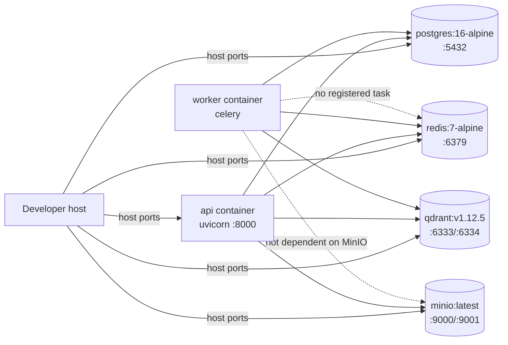
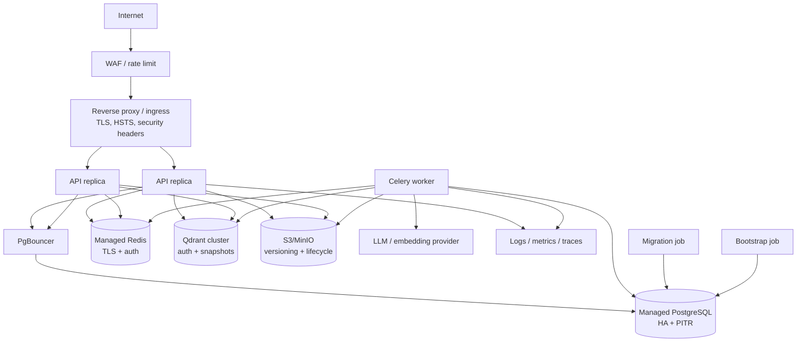

# 09 — Deployment Analysis

## 1. Summary

The repository contains a working local Docker Compose topology for PostgreSQL, Redis, Qdrant, MinIO, an API container, and a Celery worker container. It does not contain a deployable production configuration. There is no migration step, no super-admin bootstrap, no registered ingestion task, no TLS/reverse proxy, no health-managed application containers, no non-root user, no resource controls, and no observability stack. The example environment also contains a MinIO credential mismatch that will break uploads if copied as-is.

**Deployment verdict:** development-only. The Compose stack is useful for local experimentation with authentication and CRUD, not for production or a multi-tenant pilot.

## 2. Actual deployment topology

Evidence: `docker-compose.yml:1-97`.

### Services

| Service | Image/build | Ports | Persistence | Health check |
|---|---|---|---|---|
| `api` | `build: .` | `8000:8000` | None | None |
| `worker` | `build: .` | None | None | None |
| `postgres` | `postgres:16-alpine` | `5432:5432` | `postgres_data` | `pg_isready` |
| `redis` | `redis:7-alpine` | `6379:6379` | `redis_data` | `redis-cli ping` |
| `qdrant` | `qdrant/qdrant:v1.12.5` | `6333:6333`, `6334:6334` | `qdrant_data` | HTTP `/healthz` |
| `minio` | `minio/minio:latest` | `9000:9000`, `9001:9001` | `minio_data` | None |

Observations:

- Every stateful service is published on all host interfaces by default (`0.0.0.0`), not bound to `127.0.0.1`.
- PostgreSQL, Redis, Qdrant, and MinIO have no application-level authentication configured in Compose (MinIO root credentials are the exception, but they are weak defaults).
- Qdrant ports include the gRPC port `6334` but the application uses the HTTP client.
- The worker does not depend on MinIO, even though future ingestion requires object storage.
- The API and worker images are built twice from the same Dockerfile rather than sharing a named image.

## 3. Docker image

`Dockerfile`:

1. Uses `python:3.11-slim`.
2. Sets `PYTHONDONTWRITEBYTECODE` and `PYTHONUNBUFFERED`.
3. Copies `pyproject.toml`, `README.md`, `app/`, `alembic/`, and `alembic.ini`.
4. Installs with `pip install --no-cache-dir .`.
5. Runs `uvicorn` as root.

### Image findings

| ID | Severity | Finding |
|---|---|---|
| D1 | High | Installs base dependencies only; the `ai` extra (embeddings, OpenAI, Gemini) is absent, so containerized RAG cannot work when implemented. |
| D2 | High | Runs as root and has no non-root user, read-only filesystem, dropped capabilities, or seccomp profile. |
| D3 | Medium | No `HEALTHCHECK` or application-level container health probe. |
| D4 | Medium | Dependencies are installed before application code, good for caching, but `COPY pyproject.toml README.md` then `COPY app` means a code-only change still reuses the dependency layer; acceptable. The real issue is no lock file. |
| D5 | Medium | No pinned base image digest, no SBOM, no image scanning, no provenance/signing. |
| D6 | Low | No multi-stage build or build-time dependency separation; image includes test/lint metadata only if installed, which it is not, but stray caches can still be copied. `.dockerignore` correctly excludes `.env`, venvs, caches, and `.git`. |
| D7 | Low | No explicit `USER`, `WORKDIR` permissions, or entrypoint script for startup tasks. |
| D8 | Low | Single-stage build and no `PIP_NO_CACHE_DIR`/`PIP_DISABLE_PIP_VERSION_CHECK` optimization beyond `--no-cache-dir`. |

## 4. Configuration and secrets

### 4.1 Environment sources

- `docker-compose.yml` uses `env_file: .env` for `api` and `worker`.
- Compose overrides `DATABASE_URL`, `QDRANT_URL`, `REDIS_URL`, and `STORAGE_ENDPOINT_URL` with container-internal service names.
- The host-run API uses `.env` values directly, including `localhost` endpoints.
- `.env.example` is the only documented template.
- `APP_SECRET_KEY` is not present in `.env.example` and falls back to the source default in `app/core/config.py:27`.

### 4.2 Credential and endpoint mismatches

| ID | Severity | Finding |
|---|---|---|
| D9 | Critical | No `APP_SECRET_KEY` in `.env.example`; copying the example starts the API with the public default signing key. This is the deployment expression of security finding S1/S2. |
| D10 | High | `.env.example` contains a real-looking numeric `POSTGRES_PASSWORD` (not reproduced here). |
| D11 | High | MinIO credentials do not match the application credentials. Compose creates MinIO with `MINIO_ROOT_USER=local-minio-user` and `MINIO_ROOT_PASSWORD=replace-with-a-local-password`, while `.env.example` gives the API `STORAGE_ACCESS_KEY=replace-me` and `STORAGE_SECRET_KEY=replace-me`. Uploads will be rejected until one side is edited. |
| D12 | High | `STORAGE_ACCESS_KEY`/`STORAGE_SECRET_KEY` are not derived from `MINIO_ROOT_USER`/`MINIO_ROOT_PASSWORD`; operators must keep two separate credential pairs in sync manually. |
| D13 | Medium | `QDRANT_API_KEY` is empty and Qdrant has no auth; the HTTP/gRPC ports are exposed. |
| D14 | Medium | Redis has no password, TLS, or ACL; it is exposed on `6379`. |
| D15 | Medium | PostgreSQL has no TLS and is exposed on `5432` with a weak default password in Compose. |
| D16 | Medium | MinIO uses `STORAGE_SECURE=false`; production TLS termination is unspecified. |
| D17 | Low | `APP_ENVIRONMENT=development` and `APP_DEBUG=false` are copied unchanged; no environment-specific validation prevents production from using development values. |

### 4.3 Configuration behavior

- `Settings` uses prefixed groups. Compose passes unprefixed `POSTGRES_*` only for the database URL interpolation; typed app settings read `APP_*`, `DATABASE_*`, and so on.
- There is no validation that a production environment has secure cookies, HTTPS endpoints, non-default credentials, or a non-placeholder secret.
- `.env` is correctly ignored by `.gitignore` and excluded from Docker builds by `.dockerignore`.
- There is no secret manager integration, sealed secret, or per-environment template.

## 5. Database lifecycle

### 5.1 No migrations

- `alembic/versions/` contains no revision files.
- `alembic.ini` is configured and `alembic/env.py` targets `models.Base.metadata`.
- Neither Compose nor the Dockerfile runs `alembic upgrade head`.
- The API startup checks connectivity and Qdrant only; it does not create or verify tables.
- `/ready` does not check schema existence or migration version.

**Impact:** a fresh deployment starts “healthy” but every business endpoint fails with missing-relation errors. There is no repeatable schema lifecycle and no rollback story.

### 5.2 No bootstrap

- No seed script or startup hook creates a `super_admin` role/membership.
- `POST /organizations` requires super-admin access.
- New organizations do not receive default roles unless `create_initial_organization` is invoked (it is only used for first registration).
- A production deployment therefore cannot create additional tenants through the advertised API.

### 5.3 Migration ordering recommendation

Required deployment sequence:

1. Start PostgreSQL.
2. Run `alembic upgrade head` as a one-off job.
3. Run an idempotent bootstrap job for platform permissions, `super_admin`, and the first platform administrator.
4. Start the API.
5. Start the worker.
6. Verify `/ready` against schema, PostgreSQL, Redis, Qdrant, and MinIO as appropriate.

Migrations should be a separate deployment step/job, not an API startup side effect, to avoid concurrent migration races across replicas. Use a PostgreSQL advisory lock in the migration runner or a single orchestrator job.

## 6. Startup, health, and shutdown

### 6.1 Startup checks

`app/main.py` lifespan:

- Connects to PostgreSQL via `check_database_connection`.
- Ensures the Qdrant collection and payload indexes.
- Creates a Redis client but does **not** ping it.
- Does not check MinIO/bucket.
- Does not check tables or migration state.
- Does not register the worker task.

If PostgreSQL or Qdrant is unavailable at startup, the API fails to start. If Redis is unavailable, startup succeeds but authenticated requests fail later. If MinIO is unavailable, startup succeeds but uploads fail later.

### 6.2 Health endpoints

- `/health` is liveness only; correct.
- `/ready` checks PostgreSQL connectivity and Qdrant connectivity.
- `/ready` does not check Redis (needed by auth), MinIO (needed by documents), schema/migrations, or worker capacity.
- `/ready` returns 503 if Qdrant is down even though most auth/CRUD endpoints could function; this couples API availability to a feature that is not implemented.
- Every probe performs real dependency calls, so aggressive probe intervals create load.

### 6.3 Container orchestration

| ID | Severity | Finding |
|---|---|---|
| D18 | High | No restart policy or orchestrator probes; the API/worker are not health-managed as processes. |
| D19 | Medium | `minio` is only `service_started`, not `service_healthy`; there is no MinIO health check. |
| D20 | Medium | Worker does not depend on MinIO. |
| D21 | Medium | `uvicorn` runs as a single process with no worker count, proxy-header handling, or graceful timeout settings in the container command. |
| D22 | Medium | No Celery graceful shutdown, `acks_late`, prefetch, concurrency, or retry configuration. |
| D23 | Low | No `init`/pid-1 process manager; Python handles signals, but zombie/reaping behavior is less standard. |
| D24 | Low | No log rotation or centralized log sink; Docker's default JSON-file driver can grow unbounded. |

## 7. Network and exposure

| ID | Severity | Finding |
|---|---|---|
| D25 | High | All services publish ports to the host by default, including PostgreSQL, Redis, Qdrant, and MinIO. |
| D26 | High | No reverse proxy, TLS termination, HSTS, WAF, or IP allowlist in front of the API. |
| D27 | High | No network segmentation; one Compose network means a compromised API container can reach every stateful service. |
| D28 | Medium | MinIO console (`9001`) and Qdrant dashboard/API are exposed without authentication where applicable. |
| D29 | Medium | No rate limiting at the edge; login endpoints are exposed directly. |
| D30 | Low | No `internal: true` network or separate frontend/backend networks. |

For local development, bind stateful ports to `127.0.0.1` and avoid publishing them at all when using `docker compose exec`. For production, expose only the ingress; keep PostgreSQL/Redis/Qdrant/MinIO on private networks or managed services.

## 8. Background worker deployment

- The worker is built from the same image and runs `celery -A app.workers.celery_app.celery_app worker --loglevel=INFO`.
- `celery_app.py` configures JSON serialization, UTC, and `task_track_started=True`.
- `ingestion_worker.py` is a one-line stub; no task is registered.
- There is no `include` list or autodiscovery of tasks.
- No queue routing, priority, concurrency, prefetch, retry, rate limit, or dead-letter configuration.
- No worker health check, liveness probe, or metrics.
- No dedicated worker image with AI dependencies.
- The worker has no MinIO dependency in Compose despite future need.

**Impact:** uploads create `queued` jobs that never transition. Running the worker provides no product capability.

## 9. Observability and operations

| Capability | State |
|---|---|
| Structured logs | Not configured; default logger output only. |
| Request ID | Generated/propagated in response middleware, not injected into logs. |
| Metrics | None. |
| Tracing | None. |
| Error tracking | None. |
| Audit logs | Model/repository exist; no emitters. |
| Usage records | Model/repository exist; no emitters. |
| Dashboards/alerts | None. |
| Backup/restore | No configuration or documentation. |
| Disaster recovery | No RPO/RTO, replication, or restore test. |
| Log retention | Unspecified; Docker default. |
| Secret rotation | No procedure. |
| Runbooks | Only local README instructions. |
| Capacity planning | None. |

A production deployment would be effectively blind and unable to reconstruct security events or data-loss incidents.

## 10. Stateful service operations

### PostgreSQL

- Single instance, no replication, no backup job, no PITR.
- No tuning parameters, connection limits, or statement timeouts.
- Exposed to host.
- Volume only; no snapshot policy.

### Redis

- Single instance, no persistence configuration (AOF/RDB defaults may apply), no password, no TLS.
- Used for both auth revocation and Celery broker/backend. An outage breaks authentication and jobs.
- No maxmemory policy; unbounded growth can cause eviction/OOM.

### Qdrant

- Single node, no snapshots/backups, no auth, no TLS.
- Collection recreated only manually on dimension change.
- Startup writes payload indexes; no migration/versioning for collection schema.

### MinIO

- Single node, no replication, no versioning lifecycle, no object lock, no backup.
- Weak root credentials; application credential mismatch.
- Bucket created lazily on first upload; startup does not ensure it.
- No retention or secure-deletion policy.

## 11. Scaling and reliability

| Dimension | Current capability |
|---|---|
| API replicas | Possible in principle, but module-level app/engine and no shared config issues; migrations not coordinated. |
| Worker replicas | Possible, but no idempotency or task contract. |
| Database | Single primary; no read replicas or pooling proxy. |
| Redis | Single instance; broker/backend contention with auth. |
| Qdrant | Single node; no sharding/replication configured. |
| MinIO | Single node; no erasure coding/distributed mode. |
| Backpressure | None; uploads/auth/chat have no queue limits. |
| Graceful degradation | None; Qdrant outage fails readiness and auth Redis outage fails all protected requests. |
| Rollback | No migration/versioning strategy or blue/green plan. |

## 12. CI/CD and supply chain

Current state:

- No CI configuration (no `.github/workflows`, GitLab CI, Jenkins, or equivalent).
- No pre-commit hooks.
- No lock file or hash-pinned requirements.
- No image build/push pipeline, registry, scan, SBOM, or signature.
- No automated tests in deployment.
- No environment promotion (dev → staging → production).
- No deployment approval or change log.

`Dockerfile` and `docker-compose.yml` are therefore build scripts for a developer laptop, not a delivery pipeline.

## 13. Production target architecture (recommended)

### Required production controls

1. Separate migration and bootstrap jobs before rollout.
2. Secrets from a manager, never `.env` files in production.
3. Private networking for data services; ingress-only public exposure.
4. TLS everywhere; authenticated Redis/Qdrant; least-privilege MinIO credentials.
5. Non-root, read-only containers with pinned digests.
6. API and worker health/readiness probes, resource limits, and autoscaling.
7. Durable backups, PITR, Qdrant snapshots, MinIO versioning/lifecycle, and restore drills.
8. Centralized structured logs, metrics, traces, alerts, and audit/usage emission.
9. CI with lint, tests, migrations, image scan, SBOM, and signed artifacts.
10. Blue/green or rolling deployment with backward-compatible migrations and a tested rollback.
11. Rate limits at ingress and in the app; quotas per tenant.
12. Runbooks for auth outage, Redis outage, Qdrant outage, storage failure, and restore.

## 14. Deployment runbook gaps

The current README covers only local Windows-oriented setup. Missing runbooks:

- First production deployment and bootstrap
- Migration apply/rollback
- Secret rotation
- Backup/restore verification
- Tenant provisioning
- Super-admin recovery
- Worker backlog/drain
- Qdrant collection recreation on embedding-dimension change
- MinIO credential rotation
- Incident response and audit extraction
- Capacity/scale-out procedure

## 15. Deployment checklist

### Must fix before any shared environment

- [ ] Add `APP_SECRET_KEY` to deployment configuration and reject the default.
- [ ] Replace committed/weak example credentials and reconcile MinIO credentials.
- [ ] Create the initial Alembic migration and run it as a deployment job.
- [ ] Add the bootstrap command for permissions, `super_admin`, and first admin.
- [ ] Register the ingestion task or remove the worker from deployment until ready.
- [ ] Add API/worker health checks and restart policies.
- [ ] Bind stateful ports to localhost for development or remove host publishing.
- [ ] Add Redis and MinIO readiness checks where they affect the advertised path.
- [ ] Add structured logs and basic metrics.

### Required before production

- [ ] TLS ingress, security headers, and rate limiting.
- [ ] Non-root image, pinned digests, lock file, SBOM, and image scanning.
- [ ] Managed/HA data services with auth, backups, and restore tests.
- [ ] Migration/rollback and blue/green or rolling deployment procedure.
- [ ] Audit/usage emission and retention.
- [ ] Quotas, resource limits, and worker autoscaling.
- [ ] Incident/security runbooks and on-call ownership.
- [ ] Staging environment matching production.
- [ ] Load tests and capacity plan.

## 16. Deployment scorecard

| Dimension | Score (1–5) | Rationale |
|---|---:|---|
| Local topology | 3 | Compose covers all required services; MinIO health/credentials are weak. |
| Reproducibility | 2 | Docker build is simple; no lock file or pinned digests. |
| Configuration management | 1 | Insecure defaults, missing secret, credential mismatch. |
| Database lifecycle | 1 | No migrations, no bootstrap, no schema readiness. |
| Container hardening | 1 | Root user, no health checks, no resource controls. |
| Network security | 1 | Stateful ports exposed; no TLS or segmentation. |
| Background processing | 1 | No registered task. |
| Observability | 1 | No metrics, traces, structured logs, or alerts. |
| Backup/DR | 1 | None. |
| CI/CD | 1 | None. |
| Operability | 2 | Clear local commands; no production runbooks. |

## 17. Conclusion

The Compose stack is a reasonable developer sandbox, but the repository is not deployable as a production service. The minimum viable deployment requires migrations, a bootstrap path, corrected secrets/credentials, a working worker task, container health checks, and private networking. Until then, deployment should be limited to a trusted local machine with non-sensitive test data.
