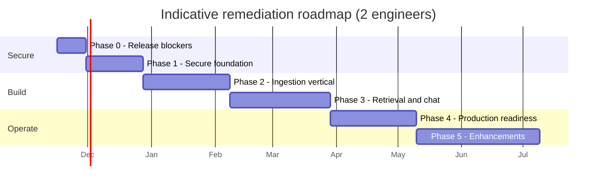
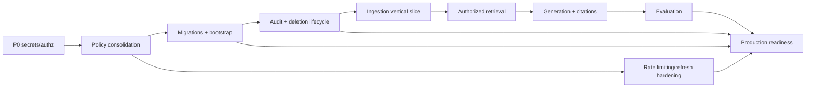

# 10 — Improvement Roadmap

## 1. Purpose

This roadmap converts the audit findings into a sequenced, measurable remediation plan. It prioritizes release blockers and the shortest path to a trustworthy product: a secure multi-tenant foundation and one complete ingestion-to-answer workflow. It deliberately avoids broad feature expansion until the core path is real and testable.

Effort and duration are indicative, not commitments. Estimates assume the existing stack, one to two experienced engineers, and no major provider or procurement delays.

## 2. Planning assumptions

- Python/FastAPI/SQLAlchemy/Qdrant/MinIO/Celery remain the target stack.
- PostgreSQL is the source of truth for metadata and authorization.
- The first production use case is an internal, multi-tenant document Q&A service.
- A single embedding provider and a single LLM provider are sufficient for the first release.
- Security and data isolation take precedence over feature breadth.
- Existing design documents are inputs, not acceptance criteria.
- The application must be deployable without manual database surgery.
- No production data should be loaded until the P0 controls in Phase 0–1 are complete.

## 3. Guiding principles

1. **Secure the perimeter before adding surface.** Fix secrets, authorization, and tenant boundaries before adding chat or ingestion features.
2. **Build one vertical slice.** Extraction → chunking → embedding → indexing → retrieval → generation → citation must work end to end before adding alternative providers or hybrid search.
3. **No empty modules in the shipped tree.** A module either implements behavior or is removed/marked with a tracked issue.
4. **Database changes are migrations.** No model-only schema changes, no startup DDL, no manual SQL.
5. **Tests accompany fixes.** Every P0 defect gets a regression test that fails before the fix.
6. **Fail closed on authorization and tenant isolation.** Fail open only where explicitly documented and monitored.
7. **Observable by default.** Each new workflow emits structured logs, metrics, audit events, and usage records.
8. **No production exposure until deployment controls exist.** A local demo is not a production readiness milestone.

## 4. Baseline and target

| Area | Current | Target for production MVP |
|---|---|---|
| Authentication | JWT/API keys, default secret, no throttling | No default secrets, rate-limited login, atomic refresh, key rotation plan |
| Authorization | Fragmented, confirmed scope leaks | Single tested policy, department scope enforced, read permissions enforced |
| Tenant isolation | Application filters, weak DB constraints | App filters + tenant FKs/composite constraints; cross-tenant tests |
| Database | 21 models, zero migrations | Initial migration, migration tests, schema readiness check |
| Bootstrap | No super-admin | Idempotent bootstrap CLI and first-admin flow |
| Documents | Upload/version/ACL, incomplete deletion | Validated uploads, storage/vector lifecycle, retryable deletion |
| Ingestion | No worker task | Idempotent Celery task with job states, retries, observability |
| RAG | Stubs | Dense retrieval, reranking, grounded answer, citations, refusal |
| Conversations | CRUD only | Paginated history, streamed answers, citation display |
| Analytics/audit | Partial/zero usage | Usage and audit events written and queryable |
| UI | Broken home route, read-only | Login/dashboard/documents/conversations usable |
| Tests | 16 narrow tests | Unit + integration + security + evaluation suites in CI |
| Deployment | Local Compose | Hardened containers, migrations, secrets, backups, probes, observability |
| Operations | Health only | Metrics, logs, traces, alerts, runbooks, restore drills |

## 5. Prioritization model

Priority combines:

- **Severity** from `01-project-overview.md`
- **Exposure**: anonymous, authenticated, admin, or operator
- **Blast radius**: one document, one tenant, all tenants, or platform
- **Dependency**: whether other work is blocked
- **Effort**: engineer-weeks

### Priority definitions

| Priority | Meaning | Target |
|---|---|---|
| P0 | Release blocker or critical security defect | Phase 0 |
| P1 | Required for a safe, supportable production MVP | Phases 1–4 |
| P2 | Valuable enhancement after the MVP | Phase 5 |
| P3 | Opportunistic or deferred | Backlog |

## 6. Phase overview

Dates are illustrative. Durations assume two engineers working in parallel where dependencies allow.

| Phase | Duration | Effort | Outcome |
|---|---:|---:|---|
| 0 — Release blockers | 1–2 weeks | 2–3 eng-weeks | No known critical authz/secret/browser defects in a shared environment |
| 1 — Secure foundation | 3–4 weeks | 5–7 eng-weeks | Enforced policy, migrations/bootstrap, audit, deletion lifecycle, CI |
| 2 — Ingestion vertical slice | 5–7 weeks | 8–10 eng-weeks | Uploaded documents are extracted, chunked, embedded, and indexed |
| 3 — Retrieval and chat | 6–8 weeks | 8–10 eng-weeks | Authorized retrieval, citations, grounded answers, streaming |
| 4 — Production readiness | 5–6 weeks | 6–8 eng-weeks | Hardened deployment, observability, backups, performance evidence |
| 5 — Enhancements | ongoing | variable | Hybrid/OCR/providers/admin UX and scale features |

**Total to production MVP:** approximately 29–38 engineer-weeks. With two engineers that is roughly 15–19 weeks of focused build time; plan 20–24 calendar weeks including review, staging, security validation, and contingency. One engineer should plan for roughly seven to nine months. Phase durations overlap and are not strictly additive.

## 7. Phase 0 — Release blockers (weeks 1–2)

### Goal

Remove the defects that make any shared or semi-trusted environment unsafe and make the application’s core flows fail visibly and predictably.

### Work items

| ID | Work | Findings | Effort |
|---|---|---|---:|
| P0-01 | Remove the default JWT secret; fail startup when absent, short, or a known placeholder; add `APP_SECRET_KEY` to the example with a placeholder that is rejected unless explicitly local. | S1, S2, D9 | 0.5 day |
| P0-02 | Enforce department scope in document management and organization-wide grants. | S3, S4 | 1–2 days |
| P0-03 | Enforce read permissions on department list/members and organization get. | S6 | 1 day |
| P0-04 | Scope department analytics to the caller’s department or require org-level permission. | S5 | 1 day |
| P0-05 | Fix `request.cookies.et` and add a browser home-route test. | Browser bug | 0.5 day |
| P0-06 | Replace committed/weak example credentials; reconcile MinIO application credentials with MinIO root credentials. | S9, D10–D12 | 1 day |
| P0-07 | Revoke access through deleted departments (cascade or active-department filter). | S8 | 1 day |
| P0-08 | Add regression tests for every P0 fix. | Testing gaps | 2 days |
| P0-09 | Add a super-admin/bootstrap command and seed default roles for new organizations. | S7 | 2–3 days |
| P0-10 | Deploy only with an initial migration and document the migration step. | Database migration gap | 2–3 days |

### Exit criteria

- Application refuses to start with the default/empty/short secret.
- A department manager cannot modify or delete another department’s document.
- A department manager cannot create an organization-wide ACL grant.
- An employee receives 403 for department/member/organization reads without the corresponding permission.
- Department analytics are scoped or denied.
- `GET /` returns a redirect/login page, not a 500.
- No committed credential is used by the example stack.
- Deleted departments no longer grant ACL access.
- A super-admin can be created through a documented, idempotent command.
- A fresh database can be migrated and the app can serve an authenticated request.
- All P0 regression tests pass in CI.

### Notes

- P0-09/P0-10 may span into Phase 1 if bootstrap and migration review take longer. They are release blockers even if scheduled slightly later.
- Do not begin ingestion or chat work before P0-02 through P0-07 are complete; building on an unsound authorization model amplifies rework.

## 8. Phase 1 — Secure foundation (weeks 3–6)

### Goal

Consolidate authorization, establish database lifecycle and audit, make deletions reliable, and create the quality gate that prevents regressions.

### Workstreams

#### 1.1 Authorization policy

- Create `app/core/policy.py` (or `app/services/authorization.py`) with pure functions:
  - `require_tenant(principal, organization_id)`
  - `require_permission(principal, *permissions)`
  - `require_department_scope(principal, department_id)`
  - `can_manage_document(principal, document)`
  - `can_read_department(principal, department)`
  - `can_grant_acl(principal, grant_type, target)`
- Replace the duplicated `_can_manage` and `_ensure_same_tenant` helpers.
- Make `require_permissions` a real dependency or delete it to avoid dead policy code.
- Add a permission matrix test: roles × resources × actions.

#### 1.2 Migrations and constraints

- Generate the initial Alembic migration from current models.
- Add:
  - `memberships.role_id` FK to `roles.id`
  - `documents.current_version_id` FK to `document_versions.id` (nullable, `use_alter`)
  - Unique index on `api_keys.key_hash`
  - ACL indexes listed in `03-database-analysis.md`
  - Department cycle handling
  - Tenant-consistency strategy (composite FKs or enforced service checks plus tests)
- Add a migration test that applies all revisions to an empty PostgreSQL database and compares the resulting schema to ORM metadata.
- Add a schema/migration check to `/ready` or a separate internal endpoint.

#### 1.3 Bootstrap and provisioning

- Add an idempotent CLI command (for example `python -m app.cli bootstrap`) that seeds the permission catalog, `super_admin` role, and first platform administrator using a one-time secret.
- When creating an organization, seed roles/permissions and either create an initial admin or issue an invitation.
- Add a test for bootstrap twice (idempotency) and for creating a second organization.

#### 1.4 Audit and usage events

- Add `audit_service.record(...)` and call it for:
  - Login success/failure, logout, refresh
  - Invitation creation/acceptance/revocation
  - Role/status changes
  - Organization/settings changes
  - Document upload/download/update/delete
  - ACL changes
  - API-key creation/revocation
- Include actor, organization, action, target type/id, request ID, safe metadata, and result.
- Add usage-record emission for embeddings/generation once those exist; for now record document and job events.
- Add read APIs for audit with pagination and admin permission.
- Define retention and redaction.

#### 1.5 Document lifecycle

- Implement a deletion saga/outbox:
  - Mark `deletion_pending`
  - Delete MinIO versions/objects idempotently
  - Delete Qdrant points idempotently
  - Mark deleted only when complete
  - Retry with bounded backoff and record attempts
- On upload, clean up the stored object if the DB transaction fails.
- Stream uploads to temporary storage/MinIO in chunks; compute hash incrementally.
- Add magic-byte validation and parser limits.
- Add a reconciliation job for orphan objects/vectors.

#### 1.6 Authentication hardening

- Move PBKDF2 to a thread pool.
- Raise the iteration count to current guidance and rehash on login.
- Make refresh rotation atomic (Redis `SET NX`/Lua) and revoke a token family on reuse.
- Add login/invite/refresh rate limits and lockout/backoff.
- Add `iss`/`aud`/`kid` and a key-rotation plan.
- Add CSRF tokens for cookie-authenticated state changes.
- Add security headers and environment-gated docs.
- Add password reset/change and admin reset (can begin here, finish before production).

#### 1.7 Testing and CI

- Fix the `httpx2` dependency typo; verify dev extras install.
- Add CI:
  - Ruff
  - Compileall
  - Unit tests
  - Integration tests with disposable PostgreSQL/Redis/Qdrant/MinIO
  - Migration-from-empty test
  - Security regression tests
- Add coverage reporting with a ratcheting threshold.
- Add a test that the default secret is rejected.

### Exit criteria

- All authorization decisions go through one tested policy module.
- Initial migration applies cleanly from empty; CI proves it.
- Bootstrap is idempotent, and a new organization gets usable roles.
- Audit events exist for every security-sensitive action.
- Document deletion removes DB state, objects, and vectors, with retries recorded.
- Login/refresh are throttled and refresh rotation is atomic.
- CI blocks merges on lint, tests, and migration failure.

## 9. Phase 2 — Ingestion vertical slice (weeks 7–12)

### Goal

Turn an uploaded document into indexed, authorized chunks. One format first (PDF or DOCX), one embedding provider, one queue, one success path.

### Scope

1. **Format support:** implement one extractor first; add DOCX/XLSX/HTML after the path is stable.
2. **Storage:** stream files to MinIO; record checksum, size, MIME, and object key; ensure the bucket at startup.
3. **Extraction:** parse in the worker with time/memory/size limits; sandbox or isolate risky formats.
4. **Cleaning:** normalize whitespace, remove control characters, preserve page/section/paragraph metadata.
5. **Chunking:** deterministic fixed-size/overlap chunker with stable chunk IDs and offsets.
6. **Embedding:** provider adapter, batching, retry, rate limits, dimension validation, cost accounting.
7. **Vector indexing:** batch Qdrant upserts with organization/document/version/chunk metadata; delete old version points.
8. **Job lifecycle:** `queued → running → succeeded/failed/cancelled`, attempts, errors, timestamps, progress.
9. **Worker contract:** registered Celery task, `acks_late`, retry policy, idempotency keyed by version, dead-letter/alert path.
10. **Observability:** structured job logs, duration/chunk/embedding metrics, failure alerts, usage records.
11. **Failure handling:** retries for transient provider/Qdrant/storage errors; terminal failure with actionable state; no duplicate chunks.
12. **Security:** re-check document authorization at job start; never index deleted/denied content; virus scan before parse if feasible.
13. **API:** expose job status and allow retry/cancel with authorization.
14. **Tests:** extractor fixtures, chunker properties, embedding fake, Qdrant contract test, idempotency, failure/retry, end-to-end ingestion.

### Exit criteria

- Uploading a supported document reaches `succeeded` without manual steps.
- Chunks and vectors exist with organization/document/version metadata.
- Re-running the job does not duplicate chunks/vectors.
- A failed extraction/provider call is retried and recorded; poison messages do not loop forever.
- Deleting a document or version removes its points.
- No unauthorized document can be indexed.
- Metrics show job latency, failure rate, chunk count, and embedding cost.

## 10. Phase 3 — Retrieval, citations, and chat (weeks 13–19)

### Goal

Answer questions only from authorized content, with citations and explicit refusal when evidence is insufficient.

### Scope

1. **Dense retrieval:** embed the query, search Qdrant with organization/ACL filters, fetch authorized chunks, deduplicate.
2. **ACL enforcement:** filter before ranking where possible; re-check authorization after retrieval; never trust payload `organization_id` alone.
3. **Reranking:** implement a cross-encoder or provider reranker behind a batchable interface.
4. **Context assembly:** token budgeting, source ordering, chunk metadata, deduplication, citation IDs.
5. **Generation:** one provider adapter with timeout, retry, token limits, and response validation.
6. **Prompting:** system prompt with citation/refusal rules; treat documents and questions as untrusted; resist prompt injection.
7. **Citations:** map model citations to authorized chunks/versions; reject or omit invalid citations; return page/section metadata.
8. **Chat API:** replace the placeholder; persist user/assistant messages; support streaming SSE with final citations.
9. **Conversation behavior:** paginate messages, enforce `chat:history_view`, scope to `(organization, user)`, support delete/export if promised.
10. **Feedback:** connect feedback to the cited answer and message; add review workflow only if required.
11. **Quotas/cost:** per-tenant token/cost limits, provider key isolation, usage records, budget alerts.
12. **Evaluation:** labeled Q&A corpus, ACL leakage tests, citation validity, groundedness, refusal, prompt-injection tests, latency/cost budgets.

### Exit criteria

- A user receives a grounded answer with valid citations from authorized documents.
- Unauthorized chunks never appear in context, citations, logs, or responses.
- Insufficient evidence returns a clear refusal, not a fabricated answer.
- The same question across tenants returns only that tenant’s content.
- Streaming works and persists exactly one assistant message per response.
- Retrieval quality meets agreed recall/groundedness thresholds on the evaluation set.
- Token/cost budgets and provider timeouts are enforced.

## 11. Phase 4 — Production readiness (weeks 20–24)

### Goal

Make the MVP safe and operable under real traffic, failure, and recovery conditions.

### Scope

1. **Deployment hardening:** non-root image, pinned digests, lock file, SBOM/scanning, separate worker image with AI extras, health checks, resource limits, restart policies.
2. **Network and secrets:** TLS ingress, private stateful services, authenticated Redis/Qdrant, MinIO least privilege, secret manager, rotation.
3. **Migrations/bootstrap:** one-off jobs, advisory lock, backup-before-migrate, rollback runbook.
4. **Observability:** structured JSON logs with request/tenant/user IDs and redaction; metrics; tracing; dashboards; alerts; error tracking.
5. **Backup/DR:** PostgreSQL PITR, Qdrant snapshots, MinIO versioning/lifecycle, restore drills with RPO/RTO.
6. **Performance:** seed realistic data; load test auth, document list, upload, chat; fix P0/P1 bottlenecks; add auth caching and missing indexes; verify pool/timeout settings.
7. **Security validation:** dependency/image scans, secret scanning, DAST/pen test, threat-model review, prompt-injection and ACL tests.
8. **Operations:** runbooks for incidents, outages, restore, rotation, tenant provisioning, worker backlog, embedding-dimension change.
9. **Compliance:** retention, deletion, audit export, data residency/provider data-handling review.
10. **Staging:** production-like environment with a full smoke test and rollback rehearsal.

### Exit criteria

- Staging and production deploy from the same artifacts and configuration schema.
- A fresh environment can be bootstrapped without manual SQL.
- Restore from backups is tested and documented.
- Alerts fire for auth failures, ingestion backlog, provider errors, Qdrant/MinIO/Redis failures, and p95 latency.
- Load tests meet agreed SLOs at target concurrency.
- No critical/high findings remain open from a focused security review.
- On-call runbooks are usable by someone who did not build the system.

## 12. Phase 5 — Enhancements

After the MVP is stable:

- Hybrid retrieval (dense + sparse/BM25) and measured fusion.
- Additional extractors (XLSX/HTML/OCR) and robust archive limits.
- Additional embedding/LLM providers with evaluation-based routing.
- Admin console for users, roles, departments, jobs, audit, and usage.
- Feedback review and quality operations.
- Password reset, MFA, session management, API-key rotation UX.
- Department hierarchy authorization and recursive ACL inheritance.
- Row-level security and composite tenant constraints as defense in depth.
- Multi-region/DR and tenant-level data residency.
- Fine-grained quotas, billing, and cost dashboards.
- Evaluation automation, regression datasets, and model upgrade gates.

## 13. P0/P1 backlog summary

| ID | Priority | Item | Phase | Owner area |
|---|---|---|---|---|
| SEC-01 | P0 | Remove/fail default JWT secret | 0 | Platform |
| SEC-02 | P0 | Department document-management scope | 0 | Backend |
| SEC-03 | P0 | Restrict organization ACL grants | 0 | Backend |
| SEC-04 | P0 | Scope analytics | 0 | Backend |
| SEC-05 | P0 | Enforce read permissions | 0 | Backend |
| SEC-06 | P0 | Super-admin/bootstrap and org roles | 0–1 | Platform |
| SEC-07 | P0 | Deleted-department access revocation | 0 | Backend/DB |
| BUG-01 | P0 | Browser home-route cookie bug | 0 | Frontend/API |
| DATA-01 | P0 | Initial migration + schema check | 0–1 | DB |
| DEP-01 | P0 | Secrets/credentials/MinIO config | 0 | DevOps |
| TEST-01 | P0 | Regression tests + CI | 0–1 | QA/Platform |
| SEC-08 | P1 | Central authorization policy | 1 | Backend |
| SEC-09 | P1 | Audit events and read API | 1 | Backend |
| SEC-10 | P1 | Rate limiting/lockout | 1 | Backend/Edge |
| SEC-11 | P1 | Atomic refresh rotation | 1 | Backend |
| SEC-12 | P1 | MIME/content validation | 1 | Backend/Worker |
| DATA-02 | P1 | Deletion saga/outbox + reconciliation | 1 | Backend/Worker |
| DATA-03 | P1 | Role/version FKs and ACL indexes | 1 | DB |
| OPS-01 | P1 | Structured logging/metrics/traces | 4 | Platform |
| OPS-02 | P1 | Backups/DR/restore drills | 4 | Platform |
| DEP-02 | P1 | Hardened image/network/TLS | 4 | DevOps |
| CORE-01 | P1 | Ingestion vertical slice | 2 | Backend/ML |
| CORE-02 | P1 | Retrieval/chat/citations | 3 | Backend/ML |
| CORE-03 | P1 | RAG evaluation suite | 3–4 | ML/QA |
| PERF-01 | P1 | Auth caching and query/index tuning | 4 | Backend/DB |
| UI-01 | P1 | Usable login/dashboard/documents/conversations | 3–4 | Frontend |
| TEST-02 | P1 | Integration/security/evaluation suites | 1–4 | QA |

## 14. Critical path and dependencies

- Ingestion depends on storage lifecycle and authorization correctness.
- Retrieval depends on chunks with tenant/document metadata and ACL enforcement.
- Generation depends on retrieval, citation mapping, and provider controls.
- Production readiness depends on migrations, audit, deletion, and observability.
- Do not parallelize chat work ahead of retrieval correctness; it produces demos that leak data.

## 15. Staffing and sequencing

### Recommended team

- 1 backend/platform engineer: authorization, migrations, API, deployment
- 1 backend/ML engineer: ingestion, retrieval, generation, evaluation
- Part-time DevOps/SRE for Phase 0 and Phase 4
- Part-time QA/security for regression and pen testing
- Product/design input for browser workflows and acceptance criteria

### If only one engineer

Sequence strictly:

1. P0 security/secret/browser fixes
2. Migration/bootstrap/tests/CI
3. Ingestion vertical slice
4. Retrieval/citations
5. Hardening/observability
6. Enhancements

Expect roughly seven to nine months to a production-capable MVP, with less parallelism and higher risk.

## 16. Risks and mitigations

| Risk | Likelihood | Impact | Mitigation |
|---|---|---|---|
| Scope expands into hybrid/multi-provider before dense path works | High | Schedule slip | Freeze Phase 2 scope to one format/provider/path. |
| Authorization fixes are partial and regress | Medium | Critical | One policy module, exhaustive matrix tests, review every route. |
| Migration on existing data fails | Medium | Outage/data loss | Test on a production-like snapshot, back up first, use transactional DDL where possible. |
| Provider limits/costs surprise the team | Medium | Budget/quality | Batch, cache, quota, measure cost per document/query early. |
| Qdrant ACL filtering is slow or leaks | Medium | Security/latency | Filter by tenant first; re-check ACLs post-retrieval; benchmark with realistic data. |
| Worker backlog or poison messages | Medium | Stalled ingestion | Idempotency, bounded retries, DLQ, backlog alerts, admin retry. |
| Prompt injection causes data exfiltration | Medium | Security/reputation | Treat content as untrusted, no tool execution, strict citation/refusal rules, evaluation corpus. |
| Production deployment drifts from local | High | Outage | Same artifacts, staging, migrations-as-code, smoke tests, runbooks. |
| Key-person dependency | Medium | Delivery risk | Pairing, runbooks, tests, documented decisions. |

## 17. Definition of done for production MVP

A release candidate is production-ready only when:

1. No critical/high audit findings remain open without an approved, time-bound exception.
2. A fresh environment can be migrated and bootstrapped entirely from documented commands.
3. Multi-tenant and department authorization tests pass, including negative cases.
4. One document type flows from upload to cited answer end to end.
5. Unauthorized retrieval is impossible in tests and review.
6. Deletion removes database state, objects, and vectors, with retries and reconciliation.
7. Audit and usage events are emitted for security-sensitive and billable actions.
8. CI blocks merges on lint, tests, migration checks, and dependency/security scans.
9. Staging has TLS, private data services, backups, alerts, and a tested restore.
10. Load tests meet agreed SLOs for login, document list, upload, and chat.
11. Runbooks exist for the top failure modes and have been exercised.
12. Product, security, and operations sign off on the release checklist.

## 18. Success metrics

Track from the first production pilot:

| Category | Metric |
|---|---|
| Security | Zero cross-tenant/ACL leaks in tests; failed-login rate; time to revoke access |
| Reliability | API availability; 5xx rate; ingestion success rate; job p95 duration |
| Performance | p50/p95 latency for auth, list, upload, chat; event-loop lag; DB pool wait |
| Quality | Retrieval recall@k; citation validity; refusal correctness; groundedness |
| Cost | Embedding cost/document; LLM cost/query; storage cost/tenant |
| Operations | Backup restore success; alert MTTA/MTTR; migration duration |
| Product | Documents ingested; questions answered; citation click-through; feedback score |

## 19. First two-week sprint

A concrete starting sprint:

**Week 1**

1. Remove the default secret; add startup validation and a regression test.
2. Fix `cookies.et`; add browser home-route test.
3. Fix department management authorization and organization ACL grants; add tests.
4. Add read-permission checks and analytics scoping; add tests.
5. Reconcile `.env.example`/Compose credentials; document local setup.

**Week 2**

6. Add deleted-department access regression and fix.
7. Generate the initial migration; run it against a clean PostgreSQL.
8. Add bootstrap CLI and organization role provisioning.
9. Add CI for Ruff, compileall, and the unit/regression suite.
10. Add an audit-event service and wire login, ACL, and delete events.
11. Add MinIO deletion to a retryable deletion path.
12. Review all route → service authorization calls with the new policy matrix.

## 20. What not to do

- Do not build hybrid search, OCR, or multi-provider routing before dense retrieval and citations work.
- Do not add new empty RAG modules to make the tree look complete.
- Do not expose the Compose stack to an untrusted network.
- Do not run the app against an unmigrated database and call it ready.
- Do not rely on documentation claims or UI labels as evidence of implemented behavior.
- Do not weaken password hashing, ACL checks, or tenant filters to improve demo speed.
- Do not attempt a full rewrite; the existing skeleton is usable if boundaries and policies are enforced.

## 21. Governance

- Track every audit finding as an issue with owner, severity, phase, and acceptance criteria.
- Review P0/P1 status weekly; no P0 can be silently deferred.
- Require a regression test and threat/tenant impact note for every security fix.
- Record architecture decisions (ADRs) for authorization, deletion semantics, queue contract, and retrieval ACLs.
- Re-run this audit after Phase 1 and Phase 3 to verify claims against code.
- Update `README.md`, deployment docs, and the traceability matrix as behavior changes.

## 22. Roadmap conclusion

The fastest route to a credible product is not more surface area. It is a short, disciplined sequence: remove the release blockers, make authorization and schema lifecycle real, complete one ingestion-to-citation path, then harden operations. The estimated 20–24 calendar weeks with two engineers is realistic only if scope is held to one format, one provider, and one retrieval path until the MVP is proven.
